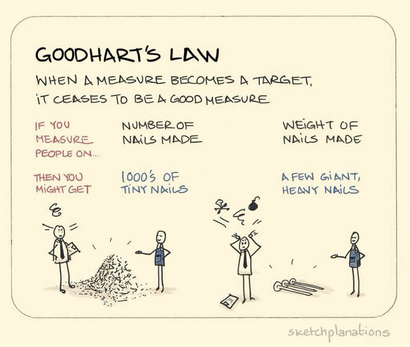

# Work log: stopwatch script

This is for Debian users only.
The panel buttons need the XFCE desktop.

## Why

Why are you not as good as you'd want to be at something?
It's often not a lack of talent or luck.
You simply didn't put in the time.
You think you worked eight hours, but you didn't.
There's a part of you that knows it, but you refuse to track time perhaps because it makes it easier for you to lie to yourself or others.
But if you really cared about excellence, you'd face the truth.
It's really hard to improve what you don't measure.

The `sw` script measures the hours you actually work.
But do you really want to know?

Now the script counts time, not attention.
But no amount of attention makes up for time you never put in.
So, all it asks of you is honesty.
Click start when you start.
When your mind wanders, bring it back or stop the timer.
That's all.
Once it's set up, it's just two clicks: one to start a task, one to stop or switch task.
Everything else is done for you.

Note for employers: The work log is mostly useless for you, unless you have an honest employee who cares about excellence.
Goodhart's law says when a measure becomes a target, it stops being a good measure.
The moment you or a client reads someone else's log, it tends to become a target.
Employees might start padding it, and the numbers stop meaning anything.



The work log is best kept private, something sacred, between you and God.

## What you get

A work log, `wlog.md` in your Documents folder, rebuilt every time you stop a task.
Here it is after two days, read at 11:20 on Tuesday:

~~~
# config (edit a value; delete a line to use its default)
```
Daily target:          8h
Working days per week: 5
Remind after:          3h
Pomodoro work:         25m
Pomodoro break:        5m
Long break:            15m
```

# log

<!-- Everything below is rebuilt from the raw log on every change: edits here are lost. Write notes above the # log line. -->

```
Updated Tue 2026-11-24 11:20

Latest day    Tue Nov 24
  1h 45m · 22% of 8h · longest 1h 00m
  work 57%, theology 43%

Day before    Mon Nov 23
  3h 00m · 38% of 8h · longest 1h 30m
  work 83%, email 17%

Latest week   Nov 23–29
  4h 45m · 12% of 40h · longest 1h 30m
  work 74%, theology 16%, email 11%

Week before   Nov 16–22
  0h 00m

November 2026   4h 45m of 48h target (10%), worked 2 of 2 working days
2026            4h 45m of 232h target (2%), worked 2 of 2 working days

Best session   1h 30m   Mon 2026-11-23
Best day       3h 00m   Mon 2026-11-23
Best week      4h 45m   Nov 23–29 2026
Best month     4h 45m   November 2026
Best year      4h 45m   2026
```

## 2026

```
To date: 4h 45m of 232h target (2%), worked 2 of 2 working days

Month    Hours   Days   Per day   Longest   Top tag
Nov     4h 45m      2    2h 23m    1h 30m   work 74%
2026    4h 45m      2    2h 23m    1h 30m   work 74%

Tag         Hours     %
work       3h 30m   74%
theology   0h 45m   16%
email      0h 30m   11%
```

### November

```
4h 45m · 2h 23m per day worked · longest 1h 30m
2 days worked of 2 working days
To date: 4h 45m of 48h target (10%), worked 2 of 2 working days
Tags: work 74%, theology 16%, email 11%

Nov 23–29   4h 45m   2 days   12% of 40h
```

- Tue 2026-11-24 — 1h 45m, 2 sessions · 09:00–11:00 · breaks 0h 15m
  - 09:00–10:00   1h 00m   work       then 0h 15m break
  - 10:15–11:00   0h 45m   theology
- Mon 2026-11-23 — 3h 00m, 3 sessions · 09:00–12:30 · breaks 0h 30m
  - 09:00–10:00   1h 00m   work       then 0h 15m break
  - 10:15–10:45   0h 30m   email      then 0h 15m break
  - 11:00–12:30   1h 30m   work
~~~

And on the XFCE panel, a button for each of the day's tasks, plus two break buttons:


The running task is bold, with `▶`, and counts up today's time for it.

## Install

You do this once.
Every step happens in a terminal.
To open one, open the Applications menu and pick Terminal Emulator.
Type or paste each command, then press Enter.
To paste in the terminal, press Ctrl+Shift+V, not Ctrl+V.
A command that works prints nothing, unless the step says what it prints.

### 1. Install what sw needs

```bash
sudo apt install python3 xfce4-genmon-plugin pulseaudio-utils libnotify-bin sound-theme-freedesktop
```

It asks for your password.
Nothing shows while you type it; that's normal.
Type it and press Enter.
If it then asks `Do you want to continue? [Y/n]`, press Enter.
It ends either by installing them, or with a line like `xfce4-genmon-plugin is already the newest version` for each one you already have.
Both are fine.

If it says `is not in the sudoers file`, you set a root password when you installed Debian, and your account can't use `sudo`.
Then type `su -`, give the root password, run the same line without `sudo` in front, and type `exit`.

### 2. Save the script

Save the [script](#the-script) in your Documents folder or wherever you wish, as `sw.py`.
Then make it runnable:

```bash
chmod +x ~/Documents/sw.py
```

`~` means your home folder, so `~/Documents` is your Documents folder.

### 3. Give it a name

```bash
mkdir -p ~/.local/bin
ln -s ~/Documents/sw.py ~/.local/bin/sw
```

`~/.local/bin` is the folder for your own commands.
The first line makes it, if it isn't there yet.
The second puts a link named `sw` in it, pointing at the script.
Typing `sw` now runs the script, and saving a new version over the script updates the command.
If `ln` says `File exists`, an old `sw` is in the way: remove it with `rm ~/.local/bin/sw` and run the `ln` line again.

### 4. Log out and back in

Then open a terminal and check:

```bash
sw version
```

It prints `sw, v` and the version number, such as `sw, v52`.

If it prints `bash: sw: command not found` instead, your session doesn't look in `~/.local/bin` yet.
Run this once, then log out and back in:

```bash
echo 'export PATH="$HOME/.local/bin:$PATH"' >> ~/.xsessionrc
```

### 5. Check the chimes

```bash
sw sound
```

It plays the two chimes, one after the other, and prints:

```
pomodoro end: playing /usr/share/sounds/freedesktop/stereo/suspend-error.oga
break end: playing /usr/share/sounds/freedesktop/stereo/complete.oga
Heard nothing? Check the volume, and that the sound isn't muted.
```

The last line always prints; if you heard both chimes, ignore it.
If something is missing, it says what, and prints the `apt` line that installs it.

## Every day

### Set the day's tasks

One word per task, in the order you want them on the panel:

```bash
sw today work theology email
```

It prints the list, numbered by button:

```
1  work
2  theology
3  email
```

The first time, it also prints a line like:

```
added task buttons 1-3 to the panel; added the short and long break buttons (panel settings backed up to ~/.cache/sw-panel-backup-20261125-085500.xml)
```

The panel disappears for a moment and comes back with the new buttons.
That's normal: `sw` has to stop the panel to add buttons.

For a two-word task, join the words with `-`, such as `deep-work`.
A name with a space stops the command: `today: task names are one word: use deep-work, not 'deep work'`.

### Start and stop

Click a task's button to start it.
Click it again to stop and log the session.
Clicking another task's button stops and logs the running one first.
Only one task runs at a time.

Hover over a button to see when it started and what a click will do.
A click redraws every button at once; otherwise they redraw every 50 seconds, so the running clock can lag by up to a minute.

### Take a break

Click `☕ 5m` for a short break, or `☕ 15m` for a long one.
The click stops and logs the running task, then starts the break.
The button turns bold and counts down, such as `☕ 4m left`.

When the break ends, you hear a chime and get a notification: `back to work`.
Your task doesn't start again by itself; click its button when you're back.

- Click the running break to end it early.
- Click the other break button to switch to it.
- Click a task's button to end the break and start the task.

A break logs nothing: the work log shows it as the gap between two sessions.

### Check your totals

```bash
sw status
```

With nothing running, it prints:

```
nothing running
Today's total: 1h 45m; 2 sessions of 25m or more

This week       Nov 23–29   4h 45m · 12% of 40h
November 2026   4h 45m of 48h target (10%), worked 2 of 2 working days
2026            4h 45m of 232h target (2%), worked 2 of 2 working days
```

"2 sessions of 25m or more" counts the sessions at least a pomodoro long.
While a task runs, the first line is `running: work, since 09:00 (0h 30m so far)`.
During a break, it starts with a line like `short break running: 4m left, ends 10:45`.

## Read the work log

Open `~/Documents/wlog.md` in any editor.
The sample at the top of this guide is a whole file.

- **Above `# log` is yours.** The settings live there, and you can add notes there. `sw` never changes it.
- **Below `# log` is rebuilt** every time a session is logged. Anything you type there is lost. To fix a session, edit the raw log; see "Fix, rename or remove sessions".
- **The dashboard** is the first box: the last two days you worked and their weeks, the month and year so far, and your best session, day, week, month and year.
- **Each year** has a row per month, then every tag with its share of the year.
- **Each month** has its total, days worked, top three tags, and a line per week.
- **Each day** lists its sessions in the order they started. A break shows at the end of the session before it: `then 0h 15m break`.

"Week before" shows `0h 00m` in the sample because tracking began on Monday Nov 23.
Once your log covers two years, a table of every year appears under the dashboard.
A week that runs into the next month, such as Nov 30 – Dec 6, is listed under the month its Monday falls in, or under the next month if nothing was logged in the first.
With more than three tags, the rest show as `other`.

## How the targets work

A target is your daily target times the number of working days.
With 8 hours and 5 working days, a full week's target is 5 × 8h = 40h.

Days before your first logged day don't count.
In the sample, tracking began on Monday Nov 23.
From then to the end of November there are 6 working days, so November's target is 6 × 8h = 48h.
4h 45m of 48h is 10%.

"Worked 2 of 2 working days" counts the working days so far that had any work.
Work on a weekend still counts toward your hours, and the month line adds it: `plus 1 other day`.

The targets only change the percentages, never the hours.

## How sw counts

**One timer.**
Panel, keyboard shortcut or terminal, it's the same timer.
Starting a task stops and logs the one before, so no minute counts twice.
There's no pause: stopping logs the session, and starting again begins a new one.
That's how the log shows your breaks.

**Every break stops work.**
A break button, `sw break`, or the break after a pomodoro: each one stops and logs the running task first, wherever it was started.
Otherwise the break would count as work.

**Under a minute isn't logged.**
That's a mis-click.
`sw stop` says `work ran under a minute, not logged`.

**Sleep doesn't count.**
Close the lid and the machine sleeps; `sw` leaves that time out.
Start `work` at 12:00, close the lid at 12:30, open it at 14:00, stop at 14:30, and `sw stop` prints:

```
logged: 2026-11-24 13:30–14:30 1h 00m work
1h 30m asleep left out; sw add 90m work puts it back
```

If you were working away from the screen meanwhile, run the `sw add` it gives you.
A pomodoro and a break count down by the clock, so one that ends during sleep has ended when you open the lid.

**Time away with the machine awake counts.**
`sw` can't see the lunch you walked off to.
Stop the timer when you stop, or click a break.

**A forgotten timer gets a reminder.**
After 3 hours awake, the button shows `⚠` instead of `▶`, and you get one notification:

```
work has been running for 3h 00m, since 09:00. Still working? If not, stop it and fix the time in the raw log.
```

Change the 3 hours with the `Remind after` setting.

**A crash or a restart.**
Everything logged is safe on disk.
Closing the terminal or logging out leaves the timer running; `sw status` and `sw stop` reach it from any terminal.
If the machine shuts down while a timer runs, `sw` can't know how long you worked, so it drops that session and tells you:

```
work was running when the machine went down (started Tue 09:00); sw stopped it without logging it. Record the time you worked with: sw add DURATION work
```

Then log what you actually worked, such as `sw add 2h work`.

## More commands

### Change the day's tasks

```bash
sw today add errands
sw today remove theology
sw today rename errands chores
```

`add` puts the task on the next button.
`remove` takes it off; the tasks after it move up one button.
`rename` renames the button, today's sessions under the old name, and the running timer if it's that task, so a typo fix keeps today's time.
Earlier days keep the old name.
Each prints the new list; `rename` first prints what it renamed, such as `renamed errands to chores: 1 session today and the running timer`.

A typo stops the command and changes nothing, such as `today: errands isn't on the list; nothing changed`.
Up to 9 tasks.
A spare button goes blank; `sw` never removes a button.
`sw today` alone prints the list; `sw today -c` blanks the task buttons.

### Time in a terminal

```bash
sw deep work
```

It starts a stopwatch tagged `deep-work` and shows the clock: `⏱  elapsed: 12:04`.
Enter stops and logs it; Ctrl+C throws it away.
If the task was already running, from the panel say, Ctrl+C only closes the view.
Closing the window leaves it running.
`sw` alone starts an untagged session.

```bash
sw pomo deep work
```

It counts 25 minutes down, chimes, logs exactly 25 minutes, then counts a 5-minute break down and chimes again.
Enter during the work stops early and logs what you did; Enter during the break skips it.
Ctrl+C during the work throws the block away; closing the window logs what you did so far.

```bash
sw break 10
```

It stops and logs the running task, then counts a 10-minute break down.
`sw break` alone uses the `Pomodoro break` length.

### Without a live view

```bash
sw start work
sw stop
sw toggle work
```

`sw stop` prints what it logged:

```
logged: 2026-11-24 09:30–10:20 0h 50m work
Today's total: 3h 10m
```

`sw toggle work` stops `work` if it's running, and starts it otherwise.
For a keyboard shortcut, add the full path in Settings > Keyboard > Application Shortcuts, such as `/home/you/.local/bin/sw toggle work`.
The break buttons work the same way: `/home/you/.local/bin/sw breakbutton short`, or `long`.

### Log time you didn't time

```bash
sw add 30m email
```

`sw` fits the time into today's breaks, latest first, so it never overlaps a session.
In the sample, at 11:20 on Tuesday, the last break is the 20 minutes since 11:00, so the other 10 go into the break before it:

```
added: 2026-11-24 10:05–10:15 0h 10m email
added: 2026-11-24 11:00–11:20 0h 20m email
Today's total: 2h 15m
```

If the breaks are too short, the rest goes before the day's first session.
Write lengths as `90m`, `1h`, `1h30m`, `5400s`, or plain minutes such as `45`, up to 24 hours.

### Short flags

| Flag | Same as |
| --- | --- |
| `-p` | `pomo` |
| `-b` | `break` |
| `-s` | `status` |
| `-a` | `add` |
| `-t` | `today` |
| `-ta` | `today add` |
| `-tr` | `today remove` |
| `-trn` | `today rename` |
| `-tc` | `today -c` |

So `sw -p deep work` runs a pomodoro, and `sw -ta errands` adds a task.

## Settings and files

### Change the settings

The settings sit at the top of the work log, above `# log`:

```
Daily target:          8h
Working days per week: 5
Remind after:          3h
Pomodoro work:         25m
Pomodoro break:        5m
Long break:            15m
```

`Working days per week: 5` means Monday to Friday; `6` adds Saturday.
`Remind after: 0h` turns the reminder off.
`Pomodoro break` is the break after a pomodoro, the `☕ 5m` button, and `sw break` with no length.
`Long break` is the `☕ 15m` button.

Edit a value and save; the work log follows on the next `sw` run, or within a minute from the panel.
Delete a line to use its default.
A line `sw` can't read stops every command with a message naming it, so don't write notes after a value.

### Fix, rename or remove sessions

Every session lives in the raw log, `~/Documents/.stopwatch_log`.
The name starts with a dot, so it's hidden; in the file manager, Ctrl+H shows it.
Stop the timer before you edit it: a session logged while the file is open in your editor is lost when you save.
Each line is one session, newest at the top:

```
2026-11-24	11:00	2700	theology
2026-11-24	10:00	3600	work
```

The date, the time the session ended, its length in seconds, and its tag.
3600 seconds is one hour, so the `work` session ran 09:00–10:00.

- To shorten it to 45 minutes, change `3600` to `2700`.
- To remove it, delete the line.
- To rename it, change the tag.

Save, and the work log follows.
A line you add anywhere moves to its place.
A line `sw` can't read moves to the top, and is left out of the totals until you fix it.
The work log names it under `Updated`, such as `⚠ raw log line 1 isn't date, HH:MM, seconds, tag; left out until you fix it: 2026-11-24 9:30 1800 email`.

To rename a tag on every day at once:

```bash
sed -i 's/\ttheolgy$/\ttheology/' ~/Documents/.stopwatch_log
```

It changes only tags that are exactly `theolgy`.
Also run `sw today rename theolgy theology` if it's on today's buttons.

### Back up

Two files hold everything:

- `~/Documents/.stopwatch_log`, the raw log: every session you ever logged.
- `~/Documents/wlog.md`, the work log: your settings and notes. The rest of it is rebuilt from the raw log.

Back up those two.
Everything else `sw` makes again, or doesn't need.

### Update sw

Open the script, `~/Documents/sw.py`, replace everything in it with the new version, and save.
You can do this with a timer running.
`sw version` then prints the new version number.

### Move the logs

The two paths are at the top of the script:

```
RAW_LOG_PATH = "~/Documents/.stopwatch_log"
WORK_LOG_PATH = "~/Documents/wlog.md"
```

Change them and save; `sw` starts the new files on its next run.
Move your old raw log to the new path first, or your history stays behind.
An update puts these paths back to the defaults, so set them again after each one.

### The files sw uses

- `~/Documents/.stopwatch_log`: the raw log.
- `~/Documents/wlog.md`: the work log.
- `~/.stopwatch_running`: the running timer, if any.
- `~/.stopwatch_break`: the break a break button started, if any.
- `~/.stopwatch_tasks`: the day's tasks.
- `~/.stopwatch_reminded`: the last session you were reminded about.
- `~/.cache/sw-panel-backup-*.xml`: the panel settings from before each change `sw today` made; the newest 5 are kept.

The logs and timer files are readable by you only.

## Fix a problem

| What you see | Meaning and fix |
| --- | --- |
| `bash: sw: command not found` | See step 4 of "Install". |
| A button shows `(genmon)` | A Generic Monitor with no command. Run `sw today` with your tasks; it takes it over. |
| A running button shows `⚠` | It has run longer than `Remind after`. Stop it if you've stopped, then fix its time in the raw log. |
| A stopped button shows `⚠` | Hover over it for the reason, usually a settings line `sw` can't read. |
| `… wasn't rebuilt (…)` | The work log couldn't be written, for the reason in brackets. The raw log is safe; fix the cause and the next `sw` run rebuilds it. |
| A button is blank | Its slot has no task today. Add one with `sw today add`. |
| No break buttons | Run `sw today` with your tasks; it adds them. |
| A button shows another task's name or time | Run `sw today` with your tasks; it renumbers the buttons. |
| The panel is gone after `sw today` | Start it with `xfce4-panel &`, then run `sw today` with your tasks again. |
| `panel not changed: … Generic Monitor plugin …` | Do step 1 of "Install", then run `sw today` again. |
| No chime, or no notification | Do step 1 of "Install", then run `sw sound`. |
| `invalid duration: …` after `sw add` | `sw add` logs time. To add a task to the panel, use `sw today add`. |
| A fix you made is gone | You edited below `# log` in the work log. Make the change in the raw log. |
| The work log is missing months | The raw log in use isn't the one with your history, often after an update reset the paths. Check the paths at the top of the script. |
| Two timers seem to run at once | An old copy of `sw` is running in a terminal. Remove it, and use the link. |

## The script

````python3
#!/usr/bin/python3 -S
# sw, v51
#
# Stopwatch, pomodoro, and work log, with optional XFCE panel buttons.
#
# Subcommands (run `sw help` for details):
#   sw [tag]               stopwatch (default)
#   sw pomo [tag]          pomodoro, then a break
#   sw break [mins]        stop work, then a break timer on its own
#   sw start|toggle [tag]  start, or start/stop, without the live view
#   sw stop                stop and log the session
#   sw status              what's running, and today's total
#   sw today [add|remove|rename] [TASK...]
#                          set or change the day's tasks; makes the panel buttons
#   sw panel SLOT          one panel button (XFCE Generic Monitor)
#   sw breakbutton KIND    what a break button's click runs
#   sw add DURATION [tag]  record a session in today's breaks
#   sw sound               play both chimes
#   sw help / version
#   Short flags: -p -b -s -a -t -ta -tr -trn -tc (see FLAGS)
#
# Python 3, standard library only.
#
# Map of this file, in order (each section starts with a `# ---- name ----` line):
#   settings          paths, chimes and the panel refresh period you may change
#   output            say/warn/notify/die; warnings from a panel click become a notification
#   formatting        minute rounding and the h/m and clock formats every report uses
#   argument parsing  durations and tags
#   config            the settings above `# log` in the work log
#   the raw log       the record: one session a line; the one parser every report uses
#   how a session reads  start-end ranges and tag names, shared by terminal and work log
#   writes            atomic replace; the raw log kept newest first; the lock;
#                     locked_change, which every change to the raw log goes through
#   the running timer the state file, change_timer (start/stop/log), crash handling,
#                     sleep, the forgotten-timer reminder, and today's figures for the buttons
#   aggregates        totals, tags, working days, targets and records
#   block renderers   everything below `# log`: dashboard, years, months, weeks, days
#   live timer        the terminal views: stopwatch, pomodoro, break, and their signals
#   modes / commands  start, stop, toggle, status, sound
#   break buttons     the two panel break timers and the process that chimes at the end
#   the panel itself  finding, adding, numbering and redrawing the XFCE buttons; today
#   mutating commands sw add, and the breaks its time goes into
#   dispatch          paths, keeping the work log in step, and main()
#
# Invariants worth knowing before changing anything:
#   - Only change_timer, discard, cmd_add and the task rename change the raw log or
#     the timer, and only inside locked_change, under one lock, with signals held.
#   - The raw log is written newest first, whole, every time (write_raw).
#   - Every figure sums each session's minutes rounded once (round_mins), so the
#     terminal, the buttons and the work log always agree.
#   - A running session's time is its awake time (Running.awake): every view of
#     it, and the row it is logged as, leave out the time the machine slept.
#   - The work log is rebuilt from the raw log, never edited in place; everything
#     above its `# log` line belongs to the user and is kept.

# ---- settings: the ones you're most likely to change ----
# Saving a new version over this file puts them back to these values, so
# note any you change. The daily target, working days, pomodoro and break
# lengths are set at the top of the work log instead.

RAW_LOG_PATH = "~/Documents/.stopwatch_log"          # the record: one line per session
WORK_LOG_PATH = "~/Documents/wlog.md"      # the readable view, rebuilt from the record
SOUND_SESSION_END = "/usr/share/sounds/freedesktop/stereo/suspend-error.oga"  # a pomodoro ends
SOUND_BREAK_END = "/usr/share/sounds/freedesktop/stereo/complete.oga"   # a break ends
SOUND_INSTALL = "sudo apt install pulseaudio-utils sound-theme-freedesktop"  # what plays them
PANEL_REFRESH_SECS = 50                    # how often buttons redraw on their own; clicks redraw at once

import datetime
import fcntl
import importlib
import io
import os
import re
import select
import signal
import sys
import termios
import time


class _Lazy:
    """A module imported on first use. Each panel button runs sw every tick,
    and most runs never need these, so they don't pay for them."""

    def __init__(self, name):
        self._name, self._mod = name, None

    def __getattr__(self, attr):
        if self._mod is None:
            self._mod = importlib.import_module(self._name)
        return getattr(self._mod, attr)


locale, shlex, shutil, subprocess, tempfile = (_Lazy(m) for m in
                                               ("locale", "shlex", "shutil", "subprocess", "tempfile"))


def _esc(text):
    """Text made safe for Pango markup and notifications."""
    return text.replace("&", "&amp;").replace("<", "&lt;").replace(">", "&gt;")


def _quote(word):
    """WORD quoted for a shell command line, as shlex.quote does."""
    if word and re.fullmatch(r"[A-Za-z0-9_@%+=:,./-]+", word):
        return word
    return "'" + word.replace("'", "'\\''") + "'"

# Marks the running task's button. A stopped task's button has no mark.
PANEL_RUNNING_MARK = "▶"

# Gaps between sessions this short are rounding (each session's start is worked
# back from its rounded length), not breaks, so the work log leaves them out.
MIN_BREAK_MINS = 2

# Panel slots: `sw panel 1` to `sw panel 9`.
MAX_SLOTS = 9


class Config:
    """The settings above `# log` in wlog.md; these are the defaults."""
    work_mins = 25
    break_mins = 5          # the pomodoro's break, and the short break button
    long_break_mins = 15    # the long break button
    daily_target = 8   # hours a working day aims for
    working_days = 5   # Monday through this weekday are working days
    remind_hours = 3   # a session running this long gets a reminder; 0 turns it off


CFG = Config()

# Set by _init_paths().
RAW_LOG = MD_LOG = STATE_FILE = TASKS_FILE = REMIND_FILE = BREAK_FILE = LOCK_DIR = LOCK_FILE = ""
LOCK_DIR_IS_FALLBACK = False

# Short flags: each stands for the words after it.
FLAGS = {
    "-p": ["pomo"], "-b": ["break"], "-s": ["status"], "-a": ["add"],
    "-t": ["today"], "-ta": ["today", "add"], "-tr": ["today", "remove"],
    "-trn": ["today", "rename"], "-tc": ["today", "-c"],
}

HELP_TEXT = r"""sw — stopwatch, pomodoro and work log, with XFCE panel buttons

Timing
  sw [tag]                 stopwatch, shown live: Enter stops & logs, Ctrl+C
                           cancels (or, for a task already running, just
                           closes the view); closing the window keeps it running
  sw pomo [tag]            pomodoro: countdown, chime, then a break
  sw break [MINUTES]       stop and log the running task, then a break timer
  sw start [tag]           start without the live view
  sw stop                  stop and log whatever is running
  sw toggle [tag]          stop tag if it's running, else start it
  sw status                what's running, today's total and sessions
  sw add DURATION [tag]    record a session you didn't time, e.g. sw add 1h30m work.
                           It fills today's breaks, the latest first, splitting
                           across breaks if it must; what's left goes before
                           the day's first session
  sw sound                 play both chimes, to check you can hear them

  There is one timer, whatever starts it. Starting a task stops and logs the
  one before; there's no pause, so starting a task again begins a new session.
  Every break stops and logs the running task. Sessions under a minute aren't
  logged. Time the machine spends asleep (a closed lid, a suspend) is left
  out, and sw says how much, with the sw add that puts it back. A timer left
  running when the machine goes down is stopped without logging; sw says so,
  and you sw add the time.

Panel buttons (XFCE)
  sw today work theology   set the day's tasks: one button each, in order
  sw today add email       add tasks to the end of the list
  sw today remove theology take tasks off the list; the ones after move up
  sw today rename theolgy theology
                           rename a task: its button, today's sessions and
                           the running timer; earlier days keep the old name
  sw today                 list them; sw today -c empties the task buttons
  Task names are one word each; join words with -, as in deep-work.
  sw makes and numbers the buttons itself, adding more when the list grows;
  a shorter list leaves the spare ones blank. After the task buttons come two
  break buttons, short and long: a click stops and logs the running task and
  starts the break, a click on a running break ends it early, and its end
  chimes. Their click runs sw breakbutton short (or long), which also works as
  a keyboard shortcut. If a button shows the wrong task, run sw today with
  your tasks again: it renumbers them. Click a task's button to start or stop
  it. A task named add, remove or rename can't start a full list: add it with
  sw today add add. Needs: sudo apt install xfce4-genmon-plugin

Short flags
  -p pomo   -b break   -s status   -a add   -t today
  -ta today add   -tr today remove   -trn today rename   -tc today -c
  So sw -p deep work runs a pomodoro tagged deep-work.

DURATION: 90m, 1h, 1h30m, 5400s, or plain minutes.
Tags: words join with -, so `sw deep work` is deep-work. For a tag named like
a command, put -- first: sw -- break.

Files
  """ + RAW_LOG_PATH + """
      raw log, the record, newest session first: date, end HH:MM, seconds,
      tag. Edit it to fix, rename or remove sessions; the work log follows on
      the next sw run. Never edit below # log in the work log: that part is
      rebuilt and your edit is lost
  """ + WORK_LOG_PATH + """
      work log, rebuilt from the raw log. Settings and notes go above its
      `# log` line; everything below is replaced. Settings: Daily target: 8h,
      Working days per week: 5, Remind after: 3h (a timer running that long
      gets a notification; 0h turns it off), Pomodoro work: 25m, Pomodoro
      break: 5m (also the short break button), Long break: 15m
  To keep the logs elsewhere, change the paths at the top of this script.
  The chimes need: """ + SOUND_INSTALL + "\n"

# ---- output ----


def _write(stream, text):
    """Write TEXT to STREAM and flush, ignoring a terminal that has gone away."""
    # Best effort: after a logout the terminal is gone, and a session being
    # committed on SIGHUP must still reach the log.
    if stream is None:
        return
    try:
        stream.write(text)
        stream.flush()
    except (OSError, ValueError):
        pass


def say(msg=""):
    _write(sys.stdout, msg + "\n")


# A list while sw runs from a panel click or a keyboard shortcut, which have no
# terminal to print to: warnings collect here and show as one desktop
# notification on exit.
NOTICES = None


def warn(msg):
    _write(sys.stderr, msg + "\n")
    if NOTICES is not None:
        NOTICES.append(msg)


def notify(body):
    if shutil.which("notify-send"):
        _run_quietly(["notify-send", "sw", _esc(body)])


def die(msg):
    warn(msg)
    sys.exit(1)


# ---- formatting ----


# Whole minutes, half a minute rounding up. Applied once to each session when
# the log is read, and every figure sums the results, so a day's sessions add
# up to its total and the terminal agrees with wlog.md.
def round_mins(secs):
    return (secs + 30) // 60


# The reports' one duration format. Zero-padded minutes keep columns aligned,
# and the h/m units keep a duration from reading as a clock time.
def fmt_mins(m):
    return "%dh %02dm" % (m // 60, m % 60)


# Clock for the live timer line: MM:SS under an hour, H:MM:SS at or above one.
def fmt_clock(s):
    m, sec = divmod(s, 60)
    if m >= 60:
        return "%d:%02d:%02d" % (m // 60, m % 60, sec)
    return "%02d:%02d" % (m, sec)


# ---- argument parsing ----

_DUR_HM = re.compile(r"([0-9]+)h([0-9]+)m?")
_DUR_ONE = re.compile(r"([0-9]+)([hms])")
_DIGITS = re.compile(r"[0-9]+")


def parse_duration(d):
    """Seconds for 90m, 1h, 1h30m, 5400s or plain minutes; None if D is none of those or is zero."""
    m = _DUR_HM.fullmatch(d)
    if m:
        total = int(m.group(1)) * 3600 + int(m.group(2)) * 60
    else:
        m = _DUR_ONE.fullmatch(d)
        if m:
            total = int(m.group(1)) * {"h": 3600, "m": 60, "s": 1}[m.group(2)]
        elif _DIGITS.fullmatch(d):
            total = int(d) * 60
        else:
            return None
    return total if total > 0 else None


# Joins the words with `-` (runs of whitespace and dashes collapse to one) and
# returns `-`, the in-band "no tag" marker, when nothing is left. A leading `--`
# is consumed; any other word starting with `-` is fatal, so a mistyped flag
# dies loudly instead of being committed to the log as tag text.
def args_to_tag(args):
    """The tag for words ARGS: joined with -, `-` when empty; dies on a word that looks like a flag."""
    if args and args[0] == "--":
        args = args[1:]
    for a in args:
        if a.startswith("-"):
            die("unknown flag: %s (tag words can't start with '-'; try sw help)" % a)
    tag = "-"
    if args:
        t = re.sub(r"[ \t\n\v\f\r]", "-", " ".join(args))
        t = re.sub(r"-{2,}", "-", t)
        if t.startswith("-"):
            t = t[1:]
        if t.endswith("-"):
            t = t[:-1]
        tag = t or "-"
    return tag


# ---- config (the section of wlog.md above `# log`) ----

_WS = r"[ \t\n\r\f\v]*"


def _read_bytes(path):
    with open(path, "rb") as f:
        return f.read()


def _lines(text):
    if not text:
        return []
    lines = text.split("\n")
    if text.endswith("\n"):
        lines.pop()
    return lines


def _config_section():
    """The lines above `# log`. Reads no further: everything below is the
    generated log, which only grows, and the panel reads this every tick."""
    section = []
    with open(MD_LOG, "rb") as f:
        for raw in f:
            line = raw.decode("utf-8", "surrogateescape").rstrip("\n")
            if line == "# log":
                break
            section.append(line)
    return section


def read_config():
    """Load the settings above `# log` into CFG; dies naming a line it can't read."""
    if not os.path.isfile(MD_LOG):
        return
    try:
        section = _config_section()
    except OSError as e:
        die("config: cannot read %s: %s" % (MD_LOG, e.strerror))

    # The first line whose whole value parses wins. A line with the key but no
    # readable value stops sw rather than silently using the default.
    for key, attr, unit, low, high, need in (
            ("Pomodoro work", "work_mins", "m", 1, None, "whole minutes, 1 or more, such as '%s: 25m'"),
            ("Pomodoro break", "break_mins", "m", 1, None, "whole minutes, 1 or more, such as '%s: 5m'"),
            ("Long break", "long_break_mins", "m", 1, None, "whole minutes, 1 or more, such as '%s: 15m'"),
            ("Daily target", "daily_target", "h", 1, 24, "whole hours, 1 to 24, such as '%s: 8h'"),
            ("Working days per week", "working_days", "", 1, 7, "a number of days, 1 to 7, such as '%s: 5'"),
            ("Remind after", "remind_hours", "h", 0, 24, "whole hours, 0 to 24, such as '%s: 3h' (0 turns it off)")):
        pat = re.compile(re.escape(key) + ":" + _WS + "([0-9]+)" + (unit + "?" if unit else "") + _WS)
        found = next((m for m in map(pat.fullmatch, section) if m), None)
        if found and low <= int(found.group(1)) <= (high or int(found.group(1))):
            setattr(CFG, attr, int(found.group(1)))
        elif found or any(line.startswith(key + ":") for line in section):
            die("config: can't read the '%s' line in %s: it needs %s, with nothing after it"
                % (key, MD_LOG, need % key))


# ---- the raw log ----
#
# One session per line: date, HH:MM (when it ended, which is when it was
# logged), seconds, tag, split on tabs or spaces. The reports read every line
# through parse_entry. A row with no tag field counts as untagged.

_DATE_RE = re.compile(r"[0-9]{4}-[0-9]{2}-[0-9]{2}")
_TIME_RE = re.compile(r"(?:[01][0-9]|2[0-3]):[0-5][0-9]")
_FIELD_SEP = re.compile(r"[ \t]+")

# Shorter sessions are accidental start/stops: no command writes one, and the
# reports leave out any found in an older or hand-edited raw log.
MIN_SESSION_SECS = 60


class Entry:
    __slots__ = ("date", "day", "hm", "secs", "mins", "tag")

    def __init__(self, date, day, hm, secs, tag):
        self.date = date
        self.day = day
        self.hm = hm
        self.secs = secs
        self.mins = round_mins(secs)
        self.tag = tag


def split_fields(line):
    return [f for f in _FIELD_SEP.split(line) if f]


def row_fields(line):
    """A raw-log row's fields, with a missing tag read as untagged: a row of
    date, HH:MM, seconds counts the same as one ending in `-`."""
    f = split_fields(line)
    return f + ["-"] if len(f) == 3 else f


def is_blank(line):
    return line.strip(" \t\r") == ""


def parse_entry(line):
    """An Entry for one raw-log LINE, or None if it isn't date, HH:MM, seconds, tag."""
    f = row_fields(line)
    if len(f) != 4:
        return None
    d, hm, s, tag = f
    if not (_DATE_RE.fullmatch(d) and _TIME_RE.fullmatch(hm) and _DIGITS.fullmatch(s)):
        return None
    try:
        day = datetime.date(int(d[0:4]), int(d[5:7]), int(d[8:10]))
    except ValueError:
        return None
    return Entry(d, day, hm, int(s), tag)


def read_raw_text():
    """The raw log as text, or None when it doesn't exist."""
    try:
        return _read_bytes(RAW_LOG).decode("utf-8", "surrogateescape")
    except FileNotFoundError:
        return None


def load_entries(text):
    """Valid entries in file order, and (line number, text) for every non-blank
    line that isn't one."""
    entries, bad = [], []
    for n, line in enumerate(_lines(text or ""), 1):
        e = parse_entry(line)
        if e is not None:
            entries.append(e)
        elif not is_blank(line):
            bad.append((n, line))
    return entries, bad


def report_entries(entries):
    """ENTRIES long enough to count, oldest first: the raw log is newest first,
    and the reports (records, ties) read in time order."""
    return sorted((e for e in reversed(entries) if e.secs >= MIN_SESSION_SECS), key=lambda e: (e.date, e.hm))


# ---- how a session reads (wlog.md and the terminal share these) ----


def _clock_mins(hm):
    return int(hm[0:2]) * 60 + int(hm[3:5])


def session_range(hm, mins):
    """`start–end` for a session logged at HH:MM, which is when it ended, that
    ran MINS minutes. One that began the evening before shows that evening's
    clock: 23:40–00:25."""
    start = (_clock_mins(hm) - mins) % 1440
    return "%02d:%02d–%s" % (start // 60, start % 60, hm)


# A tag literally named "untagged" reads the same as no tag, so it shares the
# untagged row instead of appearing twice under one name.
def _is_untagged(tag):
    return tag in ("-", "", "untagged")


def tag_label(tag):
    return "untagged" if _is_untagged(tag) else tag


def same_tag(a, b):
    return tag_label(a) == tag_label(b)


def describe_session(date, hm, secs, tag):
    """A raw-log session as the terminal echoes it, in wlog.md's terms; a
    malformed time field is shown as it stands."""
    when = session_range(hm, round_mins(secs)) if _TIME_RE.fullmatch(hm) else hm
    return "%s %s %s %s" % (date, when, fmt_mins(round_mins(secs)), tag_label(tag))


def day_total(date):
    """DATE's total in minutes, counted as wlog.md counts it."""
    try:
        entries, _ = load_entries(read_raw_text())
    except OSError:
        return 0
    return sum(e.mins for e in report_entries(entries) if e.date == date)


def say_day_total(date):
    say("Today's total: %s" % fmt_mins(day_total(date)))


# ---- writes ----


class LogUnchanged(Exception):
    """The raw log was left as it was. args[0] is the reason to print, or None
    when it has already been printed."""


class NoChange(Exception):
    """Nothing to change, so nothing to rebuild. args[0] is the caller's value."""


def _describe(e, path=""):
    if isinstance(e, OSError):
        where = e.filename or path
        return "%s: %s" % (where, e.strerror) if where else str(e.strerror)
    return "%s: %s" % (type(e).__name__, e)


def _write_all(fd, data):
    view = memoryview(data)
    while view:
        n = os.write(fd, view)
        view = view[n:]


# Temp file beside the target so the replace is a same-filesystem rename: a
# reader or a crash sees the old file or the new one, never a partial one.
def write_atomic(path, data):
    """Replace PATH's contents with DATA, all at once. A link is followed, so
    the file it points to is replaced and the link stays. The new file is
    readable by this user only."""
    path = os.path.realpath(path)
    fd, tmp = tempfile.mkstemp(prefix=os.path.basename(path) + ".", dir=os.path.dirname(path) or ".")
    try:
        try:
            _write_all(fd, data)
            os.fsync(fd)
        finally:
            os.close(fd)
        os.replace(tmp, path)
    except BaseException:
        try:
            os.unlink(tmp)
        except OSError:
            pass
        raise


def ordered_raw(lines):
    """LINES as the raw log keeps them, newest first: lines that aren't sessions
    at the top, where they're seen; then sessions by date and end time, the
    latest first, ties keeping their order; blank lines dropped."""
    bad, good = [], []
    for line in lines:
        if is_blank(line):
            continue
        e = parse_entry(line)
        if e is None:
            bad.append(line)
        else:
            good.append(((e.date, e.hm), line))
    good.sort(key=lambda g: g[0], reverse=True)  # a reversed sort is still stable
    return bad + [line for _, line in good]


def write_raw(lines):
    """Write the raw log whole, newest first, all at once: a crash or a failed
    write leaves the old file as it was. Readable by this user only."""
    data = "".join(line + "\n" for line in ordered_raw(lines))
    try:
        d = os.path.dirname(RAW_LOG)
        if d:
            os.makedirs(d, exist_ok=True)
        write_atomic(RAW_LOG, data.encode("utf-8", "surrogateescape"))
    except OSError as e:
        raise LogUnchanged("cannot write %s" % _describe(e, RAW_LOG))


def raw_lines():
    """The raw log's lines; raises LogUnchanged when it can't be read."""
    try:
        return _lines(read_raw_text() or "")
    except OSError as e:
        raise LogUnchanged("cannot read %s" % _describe(e, RAW_LOG))


def add_rows(rows):
    """Add ROWS to the raw log, which is rewritten newest first."""
    write_raw(list(rows) + raw_lines())


def _first_session(lines):
    for raw in lines:
        e = parse_entry(raw.decode("utf-8", "surrogateescape"))
        if e is not None:
            return e.date, e.hm
    return None


def raw_in_order():
    """Whether the raw log's first session is no older than its last. Two small
    reads, cheap enough for every panel tick, and they catch a log written
    oldest first, as before v50, and a row added at the bottom by hand."""
    try:
        f = open(RAW_LOG, "rb")
    except OSError:
        return True
    with f:
        head = f.read(8192)
        size = f.seek(0, os.SEEK_END)
        f.seek(max(0, size - 8192))
        tail = f.read()
    whole = size <= 8192
    top = _first_session(head.split(b"\n") if whole else head.split(b"\n")[:-1])
    bottom = _first_session(reversed(tail.split(b"\n") if whole else tail.split(b"\n")[1:]))
    return top is None or bottom is None or top >= bottom


# ---- lock ----


def acquire_lock(wait=True):
    """Exclusive flock on LOCK_FILE, waiting up to 5 seconds. Returns the fd, or
    None after printing why. With WAIT false: one silent try, None if busy."""
    try:
        if LOCK_DIR_IS_FALLBACK:
            os.makedirs(LOCK_DIR, mode=0o700, exist_ok=True)
        fd = os.open(LOCK_FILE, os.O_WRONLY | os.O_CREAT | os.O_CLOEXEC | os.O_NOFOLLOW, 0o600)
    except OSError as e:
        if wait:
            warn("cannot open lock %s" % _describe(e, LOCK_FILE))
        return None
    deadline = time.monotonic() + (5 if wait else 0)
    while True:
        try:
            fcntl.flock(fd, fcntl.LOCK_EX | fcntl.LOCK_NB)
            return fd
        except BlockingIOError:
            pass
        except OSError as e:
            os.close(fd)
            if wait:
                warn("cannot lock %s" % _describe(e, LOCK_FILE))
            return None
        if time.monotonic() >= deadline:
            os.close(fd)
            if wait:
                warn("another sw instance is running on this lock; try again in a moment")
            return None
        time.sleep(0.1)


_HELD_SIGNALS = {signal.SIGINT, signal.SIGHUP, signal.SIGTERM}


class held_signals:
    """Defers Ctrl+C, logout, and kill until the block ends, so no write is cut
    off halfway; a signal that arrived meanwhile takes effect right after."""

    def __enter__(self):
        self.old = signal.pthread_sigmask(signal.SIG_BLOCK, _HELD_SIGNALS)

    def __exit__(self, *exc):
        signal.pthread_sigmask(signal.SIG_SETMASK, self.old)
        return False


def locked_change(change):
    """Under the lock, apply change() to the raw log and rebuild wlog.md.

    change() returns a value for the caller or raises LogUnchanged. Returns
    (value, stale): stale is None when wlog.md was rebuilt, otherwise the reason
    it wasn't. The raw-log change stands either way, so the two failures are
    reported differently: a retry after a stale rebuild would log twice."""
    fd = acquire_lock()
    if fd is None:
        raise LogUnchanged(None)
    try:
        with held_signals():
            try:
                value = change()
            except NoChange as e:
                refresh_buttons()
                return e.args[0], None
            # Buttons first: they need only the raw log and the timer, which
            # are done, while the rebuild below takes longer as the log grows.
            refresh_buttons()
            try:
                regenerate_md()
            except Exception as e:  # any rebuild failure leaves the raw-log change in place
                return value, _describe(e)
            return value, None
    finally:
        os.close(fd)


def run_change(change, fail_msg):
    """Run change() through locked_change; dies with FAIL_MSG if the raw log was left as it was."""
    try:
        value, stale = locked_change(change)
    except LogUnchanged as e:
        if e.args and e.args[0]:
            warn(e.args[0])
        die(fail_msg)
    if stale:
        warn("%s was updated, but %s wasn't rebuilt (%s); sw tries again on its next run"
             % (RAW_LOG, MD_LOG, stale))
    return value


# ---- the running timer ----
#
# The session being timed is a one-line file, not a process, so the panel
# buttons, keyboard shortcuts and every terminal see one timer and any of them
# can stop it. Fields, tab-separated: tag, start, the boot it started in, and
# the machine's sleep count when it started (see sleep_clock).

KEEP = object()  # a decide() answer: leave the running session as it is


def sleep_clock():
    """Seconds this machine has spent asleep since it booted, or None where the
    kernel can't say. The boot clock keeps counting through a suspend and the
    monotonic clock doesn't, so the gap between them grows only during sleep.
    Read at a session's start and again later, it gives the sleep in between
    with no polling."""
    try:
        return int(round(time.clock_gettime(time.CLOCK_BOOTTIME)
                         - time.clock_gettime(time.CLOCK_MONOTONIC)))
    except (AttributeError, OSError):
        return None


class Running:
    __slots__ = ("tag", "start", "boot", "slept")

    def __init__(self, tag, start, boot, slept=None):
        self.tag, self.start, self.boot, self.slept = tag, start, boot, slept

    def same(self, other):
        """Whether OTHER is this session: a later start of the same tag isn't."""
        return other is not None and other.tag == self.tag and other.start == self.start

    def asleep(self):
        """Seconds the machine has slept since this session started; 0 when
        unknown, as for a timer started before v49."""
        now = sleep_clock()
        if self.slept is None or now is None:
            return 0
        return max(0, now - self.slept)

    def awake(self, now):
        """Seconds this session has run up to NOW with the machine awake."""
        return max(0, now - self.start - self.asleep())


class StateError(Exception):
    """The state file exists but can't be read as a session. args[0] says why."""


class Gone(Exception):
    """The session a caller expected was stopped or replaced meanwhile (from the
    panel, say), so nothing was changed."""


def boot_id():
    """This boot's ID, or "" where the kernel doesn't say."""
    try:
        with open("/proc/sys/kernel/random/boot_id") as f:
            return f.read().strip()
    except OSError:
        return ""


def read_state():
    """The running session, or None when nothing runs."""
    try:
        line = _read_bytes(STATE_FILE).decode("utf-8", "surrogateescape").strip()
    except FileNotFoundError:
        return None
    except OSError as e:
        raise StateError("cannot read %s" % _describe(e, STATE_FILE))
    if not line:
        return None
    f = split_fields(line)
    # Before v40 the third field was when sw last saw it running, always digits;
    # a boot field never is.
    if len(f) == 4 and _DIGITS.fullmatch(f[2]):
        del f[2]
    if len(f) == 3:  # written before v49, with no sleep count
        f.append("-")
    if len(f) == 4 and _DIGITS.fullmatch(f[1]) and (f[3] == "-" or _DIGITS.fullmatch(f[3])):
        return Running(f[0], int(f[1]), "" if f[2] == "-" else f[2],
                       None if f[3] == "-" else int(f[3]))
    raise StateError("%s isn't a running session ('%s'); fix it, or delete it to drop that "
                     "session unlogged" % (STATE_FILE, line))


def read_state_or_die():
    try:
        return read_state()
    except StateError as e:
        die(e.args[0])


def write_state(r):
    d = os.path.dirname(STATE_FILE)
    if d:
        os.makedirs(d, exist_ok=True)
    line = "%s\t%d\t%s\t%s\n" % (r.tag, r.start, r.boot or "-", "-" if r.slept is None else r.slept)
    write_atomic(STATE_FILE, line.encode("utf-8", "surrogateescape"))


def clear_state():
    try:
        os.unlink(STATE_FILE)
    except FileNotFoundError:
        pass


class Outcome:
    """What a change to the running timer did."""

    def __init__(self):
        self.ended = None    # the session stopped, if one was
        self.secs = 0        # its length as logged
        self.asleep = 0      # the sleep left out of it
        self.logged = None   # its row's (date, HH:MM); None when under a minute
        self.started = None  # the session started, if one was
        self.kept = None     # the session left running, when decide() kept it


def change_timer(decide, expect=None, secs=None, fail="failed to update the timer"):
    """Under the lock, apply decide(running session): KEEP leaves it, None stops
    it, a tag stops it and starts that tag. A stopped session is logged, lasting
    SECS, or by default the time it ran awake. If EXPECT isn't what's running,
    raises Gone. The state file changes before the row is appended, so a failed
    append loses the row (the error gives the `sw add` to restore it) instead of
    leaving the session running to be logged twice."""

    def change():
        try:
            cur = read_state()
        except StateError as e:
            raise LogUnchanged(e.args[0])
        if expect is not None and not expect.same(cur):
            raise Gone()
        out = Outcome()
        nxt = decide(cur)
        if nxt is KEEP:
            out.kept = cur
            raise NoChange(out)
        now = int(time.time())
        try:
            if nxt is not None:
                out.started = Running(nxt, now, boot_id(), sleep_clock())
                write_state(out.started)
                clear_break()  # back to work: a break button's break is over
            elif cur is not None:
                clear_state()
        except OSError as e:
            raise LogUnchanged("cannot write %s" % _describe(e, STATE_FILE))
        if cur is None:
            raise NoChange(out)
        out.ended = cur
        if secs is None:
            out.asleep = cur.asleep()
            out.secs = max(0, now - cur.start - out.asleep)
        else:
            out.secs = secs
        if out.secs < MIN_SESSION_SECS:
            raise NoChange(out)
        stamp = time.localtime(now)
        out.logged = (time.strftime("%Y-%m-%d", stamp), time.strftime("%H:%M", stamp))
        try:
            add_rows(["%s\t%s\t%d\t%s" % (out.logged[0], out.logged[1], out.secs, cur.tag)])
        except LogUnchanged as e:
            msg = "%s\n%s wasn't logged; recover it with: sw add %ds%s" % (
                e.args[0], tag_label(cur.tag), out.secs, "" if cur.tag == "-" else " " + cur.tag)
            if out.started is not None:
                msg += "\n%s is running" % tag_label(out.started.tag)
            raise LogUnchanged(msg)
        return out

    return run_change(change, fail)


def discard(expect):
    """Drop EXPECT unlogged, unless it was stopped or replaced meanwhile.
    True if it was dropped."""

    def change():
        try:
            cur = read_state()
        except StateError as e:
            raise LogUnchanged(e.args[0])
        if not expect.same(cur):
            raise NoChange(False)
        try:
            clear_state()
        except OSError as e:
            raise LogUnchanged("cannot write %s" % _describe(e, STATE_FILE))
        raise NoChange(True)

    return run_change(change, "failed to cancel the session")


def resolve_stale():
    """Drop, unlogged, a session left running across a shutdown or restart: how
    long it really ran is unknown. Returns what to tell the user, or None."""
    try:
        cur = read_state()
    except StateError:
        return None  # the caller's own read reports it
    boot = boot_id()
    if cur is None or not boot or not cur.boot or cur.boot == boot or not discard(cur):
        return None
    return ("%s was running when the machine went down (started %s); sw stopped it without "
            "logging it. Record the time you worked with: sw add DURATION %s"
            % (tag_label(cur.tag), time.strftime("%a %H:%M", time.localtime(cur.start)),
               "" if cur.tag == "-" else cur.tag))


def overdue(cur, now=None):
    """Whether running session CUR has been awake past the `Remind after` length."""
    now = int(time.time()) if now is None else now
    return bool(CFG.remind_hours) and cur is not None and cur.awake(now) >= CFG.remind_hours * 3600


def remind_once(cur):
    """One desktop notification per session that runs past `Remind after`: a
    forgotten timer otherwise inflates the log without a sign. REMIND_FILE
    records the session last reminded about, so every button and terminal
    showing it can call this and only the first notifies."""
    if not overdue(cur):
        return
    mark = "%s\t%d" % (cur.tag, cur.start)
    try:
        if _read_bytes(REMIND_FILE).decode("utf-8", "surrogateescape").strip() == mark:
            return
    except OSError:
        pass
    try:
        write_atomic(REMIND_FILE, (mark + "\n").encode("utf-8", "surrogateescape"))
    except OSError:
        return  # without the mark every tick would notify again
    notify("%s has been running for %s, since %s. Still working? If not, stop it and fix the time "
           "in the raw log." % (tag_label(cur.tag), fmt_mins(round_mins(cur.awake(int(time.time())))),
                                _since(cur.start)))


def _since(epoch):
    """When a session started: HH:MM today, with the weekday before today."""
    t = time.localtime(epoch)
    if time.strftime("%Y-%m-%d", t) == datetime.date.today().isoformat():
        return time.strftime("%H:%M", t)
    return time.strftime("%a %H:%M", t)


def _todays_rows(today):
    """TODAY's rows, read from the top of the raw log, which is newest first,
    down to the first session dated earlier: a button's work stays the same
    however long the log grows. A row hand-edited out of order counts once
    sw has put it back in order (see sync_logs)."""
    try:
        f = open(RAW_LOG, "rb")
    except FileNotFoundError:
        return []
    rows = []
    with f:
        for raw in f:
            line = raw.decode("utf-8", "surrogateescape").rstrip("\n")
            e = parse_entry(line)
            if e is None:
                continue
            if e.date < today:
                break
            if e.date == today:
                rows.append(line)
    return rows


def tag_today(tag):
    """Minutes logged today under TAG, counted as wlog.md counts them."""
    today = datetime.date.today().isoformat()
    rows = _todays_rows(today)
    entries, _ = load_entries("\n".join(rows))
    return sum(e.mins for e in report_entries(entries) if e.date == today and same_tag(e.tag, tag))


# ---- aggregates (whole minutes: every figure sums each entry's `mins`) ----


def summarize(entries):
    """Minutes logged, and days worked, for ENTRIES."""
    return sum(e.mins for e in entries), len({e.date for e in entries})


def in_range(entries, start, end):
    return [e for e in entries if start <= e.day <= end]


def tag_rows(entries):
    """Every tag as (name, minutes, percent), most time first and the name
    breaking ties, with untagged time as an "untagged" row in its place. Each
    percent is rounded on its own, so equal times always show equal shares;
    the hours column is the exact one."""
    mins = {}
    for e in entries:
        name = tag_label(e.tag)
        mins[name] = mins.get(name, 0) + e.mins
    total = sum(mins.values())
    if total <= 0:
        return []
    names = sorted(mins, key=lambda t: (-mins[t], t))
    return [(n, mins[n], (200 * mins[n] + total) // (2 * total)) for n in names]


# ---- block renderers ----

FENCE = "```"


def _table(rows, right):
    """ROWS of text cells, aligned: columns three spaces apart, those indexed in
    RIGHT right-aligned, empty columns dropped, trailing blanks trimmed."""
    widths = [max(len(r[i]) for r in rows) for i in range(len(rows[0]))]
    out = []
    for r in rows:
        cells = [c.rjust(w) if i in right else c.ljust(w)
                 for i, (c, w) in enumerate(zip(r, widths)) if w]
        out.append("   ".join(cells).rstrip())
    return out


def _day_label(d):
    return "%s %s %d" % (d.strftime("%a"), d.strftime("%b"), d.day)


def _dated(d):
    return "%s %s" % (d.strftime("%a"), d.isoformat())


def _week_label(monday):
    sunday = monday + datetime.timedelta(days=6)
    if monday.month == sunday.month:
        return "%s %d–%d" % (monday.strftime("%b"), monday.day, sunday.day)
    return "%s %d – %s %d" % (monday.strftime("%b"), monday.day, sunday.strftime("%b"), sunday.day)


def count_working_days(start, end):
    """Days from START to END, both included, that are working days."""
    if start > end:
        return 0
    full, rest = divmod((end - start).days + 1, 7)
    dow = start.weekday()  # Monday is 0
    return full * CFG.working_days + sum(1 for k in range(rest) if (dow + k) % 7 < CFG.working_days)


def to_date_line(entries, start, end, first_ever, today, prefix="To date: "):
    """The current period's line: its time against the target for the whole
    period, and how many of its working days so far had any work. Both count
    from the later of START and FIRST_EVER, the first day logged, so the time
    before tracking began counts against neither."""
    start = max(start, first_ever)
    total = sum(e.mins for e in entries)
    target = CFG.daily_target * count_working_days(start, end)
    worked = len({e.day for e in entries
                  if start <= e.day <= today and e.day.weekday() < CFG.working_days})
    line = prefix + fmt_mins(total)
    if target:
        line += " of %dh target (%s)" % (target, _pct(total, target))
    return line + ", worked %d of %d working days" % (worked, count_working_days(start, today))


def to_date_rows(entries, today, first_ever):
    """The current month's and year's to-date lines, as [label, text] rows for
    the dashboard and `sw status` to align."""
    nxt = datetime.date(today.year + today.month // 12, today.month % 12 + 1, 1)
    rows = []
    for label, start, end in ((today.strftime("%B %Y"), today.replace(day=1), nxt - datetime.timedelta(days=1)),
                              ("%04d" % today.year, datetime.date(today.year, 1, 1),
                               datetime.date(today.year, 12, 31))):
        rows.append([label, to_date_line(in_range(entries, start, end), start, end, first_ever, today,
                                         prefix="")])
    return rows


def longest(entries):
    """The longest session's minutes, or 0."""
    return max((e.mins for e in entries), default=0)


def best_records(entries):
    """The best session, day, week (by its Monday), month and year, each as
    (minutes, when); the later one wins a tie, the earlier session keeps the
    longest. Periods still running count, as today does for the best day."""
    first = None
    totals = ({}, {}, {}, {})
    for e in entries:
        if first is None or e.mins > first[0]:
            first = (e.mins, e.day)
        monday = e.day - datetime.timedelta(days=e.day.weekday())
        for t, key in zip(totals, (e.day, monday, (e.day.year, e.day.month), e.day.year)):
            t[key] = t.get(key, 0) + e.mins
    return [first] + [max(((v, k) for k, v in t.items()), default=None) for t in totals]


def render_dashboard(entries, today, bad=()):
    """When wlog.md was rebuilt; a warning for each raw-log line in BAD, (line
    number, text) pairs, since a panel rebuild has no terminal to warn in; the
    latest day worked and the one before it,
    against the daily target, and their weeks, each as a short block; the
    current month and year to date; and the records. Blocks name the dates
    they show, so a file opened days later still reads right."""
    out = [FENCE, "Updated %s" % time.strftime("%a %Y-%m-%d %H:%M")]
    if bad:
        out += [""] + ["⚠ raw log line %d isn't date, HH:MM, seconds, tag; left out until you fix it: %s"
                       % (n, line) for n, line in bad[:_BAD_LINE_SHOWN]]
        if len(bad) > _BAD_LINE_SHOWN:
            out.append("⚠ and %d more such lines" % (len(bad) - _BAD_LINE_SHOWN))
    if entries:
        days = sorted({e.day for e in entries})
        latest = days[-1]
        monday = latest - datetime.timedelta(days=latest.weekday())
        week = datetime.timedelta(days=7)
        periods = [("Latest day", _day_label(latest), latest, latest, True)]
        if len(days) > 1:
            periods.append(("Day before", _day_label(days[-2]), days[-2], days[-2], True))
        periods += [("Latest week", _week_label(monday), monday, monday + datetime.timedelta(days=6), False),
                    ("Week before", _week_label(monday - week), monday - week,
                     monday - datetime.timedelta(days=1), False)]
        width = max(len(p[0]) for p in periods)
        for label, when, start, end, target in periods:
            ents = in_range(entries, start, end)
            total = summarize(ents)[0]
            facts = [fmt_mins(total)]
            hours = CFG.daily_target * (1 if target else count_working_days(max(start, days[0]), end))
            if hours:
                facts.append(_pct_of(total, hours))
            if ents:
                facts.append("longest %s" % fmt_mins(longest(ents)))
            out += ["", "%s   %s" % (label.ljust(width), when), "  " + " · ".join(facts)]
            if ents:
                out.append("  " + tag_line(ents))
        out += [""] + _table(to_date_rows(entries, today, days[0]), set())
        session, day, wk, month, year = best_records(entries)
        out += [""] + _table([
            ["Best session", fmt_mins(session[0]), _dated(session[1])],
            ["Best day", fmt_mins(day[0]), _dated(day[1])],
            ["Best week", fmt_mins(wk[0]), _week_label(wk[1]) + " %04d" % wk[1].year],
            ["Best month", fmt_mins(month[0]), datetime.date(month[1][0], month[1][1], 1).strftime("%B %Y")],
            ["Best year", fmt_mins(year[0]), "%04d" % year[1]]], {1})
    return "\n".join(out + [FENCE]) + "\n"


def _pct(total, hours):
    """TOTAL minutes as a whole-number share of HOURS: `21%`. Every share of a
    target in sw is written this way."""
    return "%d%%" % ((200 * total + hours * 60) // (hours * 120))


def _pct_of(total, hours):
    """TOTAL minutes as a share of HOURS: `21% of 8h`."""
    return "%s of %dh" % (_pct(total, hours), hours)


def tag_line(entries, top=3):
    """The TOP tags by time, then the rest as `other`: `email 37%, work 37%, other 26%`."""
    rows = tag_rows(entries)
    shown = ", ".join("%s %d%%" % (n, p) for n, _, p in rows[:top])
    if len(rows) > top:
        total = sum(m for _, m, _ in rows)
        rest = sum(m for _, m, _ in rows[top:])
        shown += ", other %d%%" % ((200 * rest + total) // (2 * total))
    return shown


def render_tag_table(entries):
    rows = [[n, fmt_mins(m), "%d%%" % p] for n, m, p in tag_rows(entries)]
    return _table([["Tag", "Hours", "%"]] + rows, {1, 2}) if rows else []


def _per_day(total, days):
    """Minutes per day worked, rounded to the nearest minute."""
    return (2 * total + days) // (2 * days) if days else 0


def _period_row(label, entries):
    """A period's row: hours, days worked, hours per day worked, top tag. One
    with nothing logged shows its zeros."""
    total, days = summarize(entries)
    if not entries:
        return [label, fmt_mins(0), "0", "", "", ""]
    top = next(("%s %d%%" % (n, p) for n, _, p in tag_rows(entries) if n != "untagged"), "")
    return [label, fmt_mins(total), str(days), fmt_mins(_per_day(total, days)),
            fmt_mins(longest(entries)), top]


def _period_table(first_head, rows):
    return _table([[first_head, "Hours", "Days", "Per day", "Longest", "Top tag"]] + rows, {1, 2, 3, 4})


def render_years(entries):
    """A row for every year from the first logged to the latest, newest first,
    zeros included; nothing until the log covers two years."""
    years = sorted({e.day.year for e in entries})
    if len(years) < 2:
        return ""
    rows = [_period_row("%04d" % y, [e for e in entries if e.day.year == y])
            for y in range(years[-1], years[0] - 1, -1)]
    return "\n" + "\n".join([FENCE] + _period_table("Year", rows) + [FENCE]) + "\n"


def render_year(year, entries, first_month, first_day, today):
    """A row for every month from FIRST_MONTH to the year's latest month worked
    (December for a year since ended), newest first, zeros included, and the
    year's total last; then the year's tags. The current year opens with its
    to-date line, counted from FIRST_DAY, the first day logged."""
    last = 12 if year < today.year else max(e.day.month for e in entries)
    rows = [_period_row(datetime.date(year, m, 1).strftime("%b"),
                        [e for e in entries if e.day.month == m])
            for m in range(last, first_month - 1, -1)]
    rows.append(_period_row("%04d" % year, entries))
    out = [FENCE]
    if year == today.year:
        out += [to_date_line(entries, datetime.date(year, 1, 1), datetime.date(year, 12, 31),
                             first_day, today), ""]
    out += _period_table("Month", rows) + [""] + render_tag_table(entries) + [FENCE]
    return "\n".join(out) + "\n"


def render_weeks(year, month, entries, first, latest, lead):
    """A line for each Monday-to-Sunday week that starts in the month, latest
    first: its full total, days worked and share of its target (counted from
    FIRST in the week tracking began), so a week that runs into the next
    month is listed under the month it started in. With LEAD, the month before
    has nothing logged, so the week running into this month is listed here,
    or it would show nowhere. ENTRIES needs this month and the next. Weeks
    that start after LATEST, the latest day worked, or end before FIRST, the
    first, are left out."""
    day = datetime.date(year, month, 1)
    last = datetime.date(year + month // 12, month % 12 + 1, 1) - datetime.timedelta(days=1)
    day += datetime.timedelta(days=-day.weekday() if lead else (7 - day.weekday()) % 7)
    rows = []
    while day <= last and day <= latest:
        end = day + datetime.timedelta(days=6)
        if end >= first:
            total, days = summarize(in_range(entries, day, end))
            target = CFG.daily_target * count_working_days(max(day, first), end)
            rows.append([_week_label(day), fmt_mins(total),
                         "%d %s" % (days, "day" if days == 1 else "days"),
                         _pct_of(total, target) if target else ""])
        day += datetime.timedelta(days=7)
    return _table(rows[::-1], {1, 2, 3}) if rows else []


def render_month(year, month, entries, nearby, first, latest, today, lead):
    """A month's block: totals; days worked against working days (to TODAY in
    the current month); its to-date line while current; its top tags; and
    its weeks. NEARBY holds this month's and the next month's sessions, for
    weeks that run on; FIRST and LATEST are the first and latest days logged;
    LEAD as for render_weeks."""
    total, days = summarize(entries)
    start = max(datetime.date(year, month, 1), first)
    nxt = datetime.date(year + month // 12, month % 12 + 1, 1)
    end = min(nxt - datetime.timedelta(days=1), today)
    on = len({e.day for e in entries if e.day.weekday() < CFG.working_days})
    head = fmt_mins(total)
    if days:
        head += " · %s per day worked · longest %s" % (fmt_mins(_per_day(total, days)),
                                                        fmt_mins(longest(entries)))
    worked = "%d %s worked of %d working days" % (on, "day" if on == 1 else "days",
                                                   count_working_days(start, end))
    if days > on:
        worked += ", plus %d other %s" % (days - on, "day" if days - on == 1 else "days")
    out = [FENCE, head, worked]
    if (year, month) == (today.year, today.month):
        out.append(to_date_line(entries, datetime.date(year, month, 1), nxt - datetime.timedelta(days=1),
                                first, today))
    weeks = render_weeks(year, month, nearby, first, latest, lead)
    if entries:
        out.append("Tags: " + tag_line(entries))
    out += ([""] + weeks if weeks else []) + [FENCE]
    return "\n".join(out) + "\n"


def _start_order(e):
    end = _clock_mins(e.hm)
    return (end - e.mins, end, e.secs, e.tag)


def _hm(mins):
    m = mins % 1440
    return "%02d:%02d" % (m // 60, m % 60)


def day_timeline(sessions):
    """A day's sessions in the order they started, with the breaks between them:
    a list of (start, end, entry) in minutes from that midnight, entry None for
    a break. A session that began the evening before starts below zero. Gaps
    under MIN_BREAK_MINS, and sessions overlapping one before them (an `sw add`
    over timed work, say), add no break."""
    out, reach = [], None
    for e in sorted(sessions, key=_start_order):
        end = _clock_mins(e.hm)
        start = end - e.mins
        if reach is not None and start - reach >= MIN_BREAK_MINS:
            out.append((reach, start, None))
        out.append((start, end, e))
        reach = end if reach is None else max(reach, end)
    return out


def render_days(entries):
    """Days latest first. Each day's line gives its total, sessions, and, with
    more than one, when the first started and the last ended and the breaks in
    between; under it, the sessions in the order they started, each ending
    with the break that followed it, if any."""
    by_day = {}
    for e in entries:
        by_day.setdefault(e.day, []).append(e)
    width = max(len(fmt_mins(e.mins)) for e in entries)
    tag_width = max(len(tag_label(e.tag)) for e in entries)
    out = []
    for d in sorted(by_day, reverse=True):
        sessions = by_day[d]
        n = len(sessions)
        line = "- %s — %s, %d %s" % (_dated(d), fmt_mins(sum(e.mins for e in sessions)), n,
                                     "session" if n == 1 else "sessions")
        timeline = day_timeline(sessions)
        if n > 1:
            first = min(a for a, _, _ in timeline)
            last = max(b for _, b, _ in timeline)
            line += " · %s–%s" % (_hm(first), _hm(last))
            breaks = sum(b - a for a, b, e in timeline if e is None)
            if breaks:
                line += " · breaks %s" % fmt_mins(breaks)
        out.append(line)
        for i, (a, b, e) in enumerate(timeline):
            if e is None:
                continue
            row = "  - %s–%s   %s   %s" % (_hm(a), _hm(b), fmt_mins(e.mins).rjust(width),
                                          tag_label(e.tag))
            nxt = timeline[i + 1] if i + 1 < len(timeline) else None
            if nxt is not None and nxt[2] is None:
                row = "%s   then %s break" % (row.ljust(len(row) - len(tag_label(e.tag)) + tag_width),
                                              fmt_mins(nxt[1] - nxt[0]))
            out.append(row)
    return "".join(line + "\n" for line in out)


def render_config_seed():
    """Written once, when wlog.md is first created."""
    return ("# config (edit a value; delete a line to use its default)\n" + FENCE + "\n"
            + "Daily target:          %dh\nWorking days per week: %d\n" % (CFG.daily_target, CFG.working_days)
            + "Remind after:          %dh\n" % CFG.remind_hours
            + "Pomodoro work:         %dm\nPomodoro break:        %dm\n" % (CFG.work_mins, CFG.break_mins)
            + "Long break:            %dm\n" % CFG.long_break_mins
            + FENCE + "\n\n")


_BAD_LINE_SHOWN = 5

# Written under `# log` on every rebuild. Before v33 nothing said so, and notes
# typed below `# log` were lost on the next rebuild.
GENERATED_NOTE = ("<!-- Everything below is rebuilt from the raw log on every change: edits here are "
                  "lost. Write notes above the # log line. -->\n")


def regenerate_md():
    """Rebuild wlog.md from the raw log, keeping everything above `# log`.
    Lines of the raw log that aren't sessions are named on stderr and left out;
    sessions under a minute are left out silently. Afterwards wlog.md carries
    the raw log's modified time, so sync_logs can tell when either was edited."""
    raw_mtime = _mtime(RAW_LOG)
    entries, bad = load_entries(read_raw_text()) if os.path.isfile(RAW_LOG) else ([], [])
    for n, line in bad[:_BAD_LINE_SHOWN]:
        warn("warning: %s line %d isn't date, HH:MM, seconds, tag; left out of the totals: %s"
             % (RAW_LOG, n, line))
    if len(bad) > _BAD_LINE_SHOWN:
        warn("warning: %d more such lines in %s" % (len(bad) - _BAD_LINE_SHOWN, RAW_LOG))

    d = os.path.dirname(MD_LOG)
    if d:
        os.makedirs(d, exist_ok=True)
    # Keep everything above `# log`. A file with no `# log` line keeps all of it,
    # plus a separating blank line. Only a missing or empty file gets the seeded
    # config block, so a block the user deletes stays gone.
    if os.path.exists(MD_LOG) and os.path.getsize(MD_LOG) > 0:
        text = _read_bytes(MD_LOG).decode("utf-8", "surrogateescape")
        head, found = [], False
        for line in _lines(text):
            if line == "# log":
                found = True
                break
            head.append(line)
        header = "".join(line + "\n" for line in head) + ("" if found else "\n")
    else:
        header = render_config_seed()

    entries = report_entries(entries)
    by_month = {}
    for e in entries:
        by_month.setdefault((e.day.year, e.day.month), []).append(e)
    today = datetime.date.today()  # once, so a rebuild across midnight reads one day throughout
    parts = [header, "# log\n\n", GENERATED_NOTE, "\n", render_dashboard(entries, today, bad), render_years(entries)]
    first = min(by_month) if by_month else None
    days = sorted({e.day for e in entries}) if entries else []
    year = None
    for (y, m) in sorted(by_month, reverse=True):
        if y != year:
            year = y
            parts.append("\n## %04d\n\n" % y)
            parts.append(render_year(y, [e for e in entries if e.day.year == y],
                                     first[1] if y == first[0] else 1, days[0], today))
        parts.append("\n### %s\n\n" % datetime.date(y, m, 1).strftime("%B"))
        nxt = (y + m // 12, m % 12 + 1)
        prev = (y - 1, 12) if m == 1 else (y, m - 1)
        parts.append(render_month(y, m, by_month[(y, m)], by_month[(y, m)] + by_month.get(nxt, []),
                                  days[0], days[-1], today, prev not in by_month))
        parts.append("\n" + render_days(by_month[(y, m)]))
    write_atomic(MD_LOG, "".join(parts).encode("utf-8", "surrogateescape"))
    if raw_mtime is not None:
        os.utime(MD_LOG, ns=(time.time_ns(), raw_mtime))


# ---- live timer ----


class Timer:
    session = None            # the session this terminal shows; None for a break
    started_here = False      # Ctrl+C drops a session only if this terminal started it
    commit_on_hangup = False  # pomodoro work: its countdown can't outlive the terminal
    completed = False         # a countdown reached zero (never, for the count-up)
    gone = False              # the session was stopped or replaced elsewhere
    exiting = False           # a signal is already ending this process


TIMER = Timer()


def open_tty():
    """/dev/tty, which the timer reads for Enter. Checked before anything is
    printed: without a controlling terminal the timer can't run."""
    try:
        return os.open("/dev/tty", os.O_RDONLY | os.O_CLOEXEC)
    except OSError:
        die("sw needs a terminal: no readable /dev/tty, so the timer can't run")


def _exit_now(code):
    _write(sys.stdout, "")
    _write(sys.stderr, "")
    os._exit(code)


def _exiting():
    """True if a signal is already ending this process; otherwise claims the
    exit, holding further signals so the first one finishes what it started."""
    if TIMER.exiting:
        return True
    TIMER.exiting = True
    signal.pthread_sigmask(signal.SIG_BLOCK, _HELD_SIGNALS)
    return False


# Ctrl+C drops a session this terminal started, on purpose, and says so. On a
# session it found already running it only closes the view: an hour started
# from the panel shouldn't vanish because a terminal was attached to it. During
# a break there is nothing to drop: the pomodoro before it is already logged.
def _on_interrupt(signum, frame):
    """Ctrl+C in a live view: drop a session this terminal started, else just close the view."""
    if _exiting():
        return
    s = TIMER.session
    if s is None:
        _write(sys.stdout, "\n\n⏹ break cancelled\n")
    elif not TIMER.started_here:
        _write(sys.stdout, "\n\n⏹ left the live view; %s keeps running (sw stop stops it)\n"
               % tag_label(s.tag))
    else:
        try:
            dropped = discard(s)
        except SystemExit as e:
            _exit_now(e.code if isinstance(e.code, int) else 1)
        _write(sys.stdout, "\n\n⏹ cancelled, nothing logged\n" if dropped
               else "\n\n⏹ already stopped elsewhere\n")
    _exit_now(130)


def _hangup(code):
    """The terminal went away or `kill` arrived during a pomodoro's work phase:
    log the work so far, then exit with the conventional 128+signal code. A
    stopwatch needs no handler, as its session lives on in the state file."""
    if _exiting():
        return
    _write(sys.stderr, "\n\n⏹ terminated by signal\n")
    try:
        change_timer(lambda c: None, expect=TIMER.session, fail="failed to commit session")
    except Gone:
        pass
    except SystemExit as e:
        _exit_now(e.code if isinstance(e.code, int) else 1)
    _exit_now(code)


def _on_terminate(signum, frame):
    _hangup(129 if signum == signal.SIGHUP else 143)


def _enter_pressed(tty, timeout):
    """True once a line has been typed. Ctrl+D on a live terminal is ignored; a
    terminal that has gone away (read at EOF and no longer a working tty) is
    handled as the hangup it is, even where SIGHUP never arrives."""
    ready, _, _ = select.select([tty], [], [], timeout)
    if not ready:
        return False
    try:
        data = os.read(tty, 4096)
    except OSError:
        data = b""
    if data:
        return True
    try:
        termios.tcgetattr(tty)
        return False
    except termios.error:
        pass
    if TIMER.commit_on_hangup:
        _hangup(129)
    _exit_now(129)


# One-second live timer shared by the stopwatch, the pomodoro work phase, and
# the break, so their displays are identical by construction. The count-up
# shows the session's awake time, so a suspend doesn't inflate it; the
# countdowns run on wall-clock time, so a block or break that ends during a
# suspend has ended when the lid opens. A session's timer counts from the
# session's start, so a stopwatch that found its tag already running shows the
# whole run, and it stops showing when the session is stopped or replaced
# elsewhere. Each redraw ends with EL (\033[K) so a clock that shrinks at the
# hour boundary (1:00:00 -> 59:59) leaves no stale columns.
def run_timer(tty, mode, icon, label, total=0):
    """Draw the live clock once a second until Enter, the countdown ends, or the session is stopped elsewhere."""
    s = TIMER.session
    origin = s.start if s is not None else int(time.time())
    TIMER.completed = TIMER.gone = TIMER.exiting = False
    signal.signal(signal.SIGINT, _on_interrupt)
    if TIMER.commit_on_hangup:
        signal.signal(signal.SIGHUP, _on_terminate)
        signal.signal(signal.SIGTERM, _on_terminate)
    try:
        while True:
            now = int(time.time())
            if s is not None:
                try:
                    latest = read_state()
                except StateError:
                    latest = None
                if not s.same(latest):
                    TIMER.gone = True
                    break
            if s is not None and now % 60 == 0:
                remind_once(s)
            if mode == "down":
                remaining = max(0, total - (now - origin))
                _write(sys.stdout, "\r   %s  %s: %s \033[K" % (icon, label, fmt_clock(remaining)))
                if remaining == 0:
                    TIMER.completed = True
                    break
            else:
                shown = s.awake(now) if s is not None else now - origin
                _write(sys.stdout, "\r   %s  %s: %s \033[K" % (icon, label, fmt_clock(shown)))
            if _enter_pressed(tty, 1.0):
                break
    finally:
        for sig in (signal.SIGINT, signal.SIGHUP, signal.SIGTERM):
            signal.signal(sig, signal.SIG_DFL)


def _hm_in(seconds):
    return time.strftime("%H:%M", time.localtime(time.time() + seconds))


def _run_quietly(cmd, **kw):
    try:
        subprocess.run(cmd, check=False, **kw)
    except OSError:
        pass


def play_sound(path):
    if shutil.which("paplay"):
        _run_quietly(["paplay", path], stderr=subprocess.DEVNULL)


def _break_over():
    play_sound(SOUND_BREAK_END)
    if shutil.which("notify-send"):
        _run_quietly(["notify-send", "⏰ break over", "back to work"])


def cmd_sound(args):
    """`sw sound`: play both chimes the way sw plays them, saying what's missing."""
    if args:
        die("sound: takes no arguments")
    if not shutil.which("paplay"):
        die("paplay isn't installed, so sw plays no chimes; install it with: %s" % SOUND_INSTALL)
    for label, path in (("pomodoro end", SOUND_SESSION_END), ("break end", SOUND_BREAK_END)):
        if not os.path.isfile(path):
            say("%s: %s is missing; install it with: %s" % (label, path, SOUND_INSTALL))
            continue
        say("%s: playing %s" % (label, path))
        try:
            r = subprocess.run(["paplay", path], stderr=subprocess.PIPE, text=True, timeout=30)
        except (OSError, subprocess.TimeoutExpired) as e:
            say("   paplay couldn't play it: %s" % _describe(e))
            continue
        if r.returncode:
            say("   paplay couldn't play it: %s" % (r.stderr.strip() or "exit %d" % r.returncode))
        time.sleep(0.5)
    say("Heard nothing? Check the volume, and that the sound isn't muted.")


# ---- modes ----


def _say_asleep(out):
    """How much sleep a stopped session left out, and the `sw add` that puts it
    back; nothing when it slept under half a minute."""
    m = round_mins(out.asleep)
    if out.ended is None or not m:
        return
    say("%s asleep left out; sw add %dm%s puts it back"
        % (fmt_mins(m), m, "" if out.ended.tag == "-" else " " + out.ended.tag))


def _say_stopped(out):
    """The session a timer change stopped, if any, as it was logged."""
    if out.ended is None:
        return
    if out.logged:
        say("logged: %s" % describe_session(out.logged[0], out.logged[1], out.secs, out.ended.tag))
    else:
        say("%s ran under a minute%s, not logged" % (tag_label(out.ended.tag),
                                                     " awake" if round_mins(out.asleep) else ""))
    _say_asleep(out)


def _say_stale():
    msg = resolve_stale()
    if msg:
        warn(msg)


def _finish(s, secs=None):
    """Stop S from its live view and log it; SECS overrides the time it ran."""
    try:
        out = change_timer(lambda c: None, expect=s, secs=secs, fail="failed to commit session")
    except Gone:
        say("already stopped elsewhere")
        return
    if out.logged is None:
        say("under a minute, not logged")
        _say_asleep(out)
        return
    say("Session: %s" % fmt_mins(round_mins(out.secs)))
    _say_asleep(out)
    say_day_total(out.logged[0])


def run_stopwatch(tag):
    """`sw [tag]`: start TAG (or join it if running) and show it live until Enter or Ctrl+C."""
    tty = open_tty()
    _say_stale()
    out = change_timer(lambda cur: KEEP if cur is not None and same_tag(cur.tag, tag) else tag)
    _say_stopped(out)
    TIMER.commit_on_hangup = False
    if out.kept is not None:
        TIMER.session, TIMER.started_here = out.kept, False
        say("⏱  %s has been running since %s. Enter stops & logs, Ctrl+C leaves it running."
            % (tag_label(tag), _since(out.kept.start)))
    else:
        TIMER.session, TIMER.started_here = out.started, True
        say("⏱  stopwatch started %s. Enter stops & logs, Ctrl+C cancels." % time.strftime("%H:%M"))
    say("   Closing this window leaves the timer running.")
    say("")
    run_timer(tty, "up", "⏱", "elapsed")
    say("")
    say("")
    if TIMER.gone:
        say("⏹ stopped elsewhere (the panel, a shortcut, or another sw)")
        return
    say("⏹ stopped")
    _finish(TIMER.session)


def run_pomodoro(tag):
    """`sw pomo [tag]`: a fresh work block counted down, logged at its set length, then a break."""
    tty = open_tty()
    _say_stale()
    mins = CFG.work_mins
    out = change_timer(lambda cur: tag)  # a fresh block, even if tag was running
    _say_stopped(out)
    TIMER.session, TIMER.started_here, TIMER.commit_on_hangup = out.started, True, True
    say("🍅 pomodoro started! focus for %d minutes." % mins)
    say("   Started %s, ends %s. Enter stops early & logs, Ctrl+C cancels."
        % (time.strftime("%H:%M"), _hm_in(mins * 60)))
    say("")
    run_timer(tty, "down", "⏱", "time remaining", mins * 60)
    say("")
    say("")
    s = TIMER.session
    TIMER.session, TIMER.commit_on_hangup = None, False
    if TIMER.gone:
        say("⏹ stopped elsewhere (the panel, a shortcut, or another sw)")
    elif TIMER.completed:
        # A countdown that reaches zero logs its set length, so a suspend
        # mid-block doesn't inflate the logged focus.
        say("✅ session complete!")
        _finish(s, mins * 60)
        play_sound(SOUND_SESSION_END)
        say("")
        run_break(tty, CFG.break_mins)
    else:
        say("⏹ stopped early")
        _finish(s)


# Rest timer shared by the pomodoro and `sw break`. Logs nothing.
def run_break(tty, mins):
    """Count a MINS-minute break down; logs nothing."""
    say("%dm break. Press Enter to skip." % mins)
    say("   Break ends %s" % _hm_in(mins * 60))
    say("")
    run_timer(tty, "down", "☕", "break remaining", mins * 60)
    say("")
    say("")
    if TIMER.completed:
        say("⏰ break over!")
        _break_over()
    else:
        say("⏭ break skipped")


def cmd_break(args):
    """`sw break [MINUTES]`: stop and log the running task, then a break timer."""
    mins, got = CFG.break_mins, False
    for a in args:
        if a.startswith("-"):
            die("break: unknown flag: %s" % a)
        if got:
            die("break: only one minutes value allowed (got extra '%s')" % a)
        m = re.fullmatch(r"([0-9]+)m?", a)
        if not m:
            die("break: minutes must be a positive integer (got '%s')" % a)
        if int(m.group(1)) < 1:
            die("break: minutes must be >= 1")
        mins, got = int(m.group(1)), True
    tty = open_tty()
    stop_for_break()
    run_break(tty, mins)


def stop_for_break():
    """Every break starts by stopping and logging the running task, if any."""
    _say_stale()
    out = change_timer(lambda cur: None, fail="failed to stop the running task")
    _say_stopped(out)
    if out.logged:
        say_day_total(out.logged[0])
    return out


# ---- the timer without a live view: commands, shortcuts, panel buttons ----


def _timer_command(decide):
    """Apply DECIDE to the timer without a live view, and say what happened."""
    _say_stale()
    out = change_timer(decide)
    _say_stopped(out)
    if out.started is not None:
        say("started %s at %s" % (tag_label(out.started.tag), _since(out.started.start)))
    elif out.kept is not None:
        say("%s is already running, since %s" % (tag_label(out.kept.tag), _since(out.kept.start)))
    elif out.ended is None:
        say("nothing running")
    if out.logged:
        say_day_total(out.logged[0])


def cmd_start(args):
    tag = args_to_tag(args)
    _timer_command(lambda cur: KEEP if cur is not None and same_tag(cur.tag, tag) else tag)


def cmd_stop(args):
    if args:
        die("stop: takes no arguments")
    _timer_command(lambda cur: None)


def cmd_toggle(args):
    tag = args_to_tag(args)
    _timer_command(lambda cur: None if cur is not None and same_tag(cur.tag, tag) else tag)


def _tilde(path):
    home = os.environ.get("HOME", "")
    return "~" + path[len(home):] if home and path.startswith(home + "/") else path


def _work_length():
    """How many of today's logged sessions were at least a pomodoro long."""
    today = datetime.date.today().isoformat()
    n = sum(1 for e in report_entries(load_entries("\n".join(_todays_rows(today)))[0])
            if e.date == today and e.mins >= CFG.work_mins)
    return "%d %s of %dm or more" % (n, "session" if n == 1 else "sessions", CFG.work_mins)


def cmd_status(args):
    """`sw status`: what's running, today's total, then this week and the month and year to date."""
    if args:
        die("status: takes no arguments")
    _say_stale()
    cur = read_state_or_die()
    b = running_break()
    if b is not None:
        say("%s break running: %dm left, ends %s" % (b.kind, (b.end - int(time.time()) + 59) // 60,
                                                     time.strftime("%H:%M", time.localtime(b.end))))
    total = day_total(datetime.date.today().isoformat())
    if cur is None:
        say("nothing running")
        say("Today's total: %s; %s" % (fmt_mins(total), _work_length()))
        _say_periods(None)
        return
    now = int(time.time())
    run = round_mins(cur.awake(now))
    asleep = round_mins(cur.asleep())
    say("running: %s, since %s (%s so far%s)%s" % (
        tag_label(cur.tag), _since(cur.start), fmt_mins(run),
        ", not counting %s asleep" % fmt_mins(asleep) if asleep else "",
        " — still working?" if overdue(cur, now) else ""))
    say("Today's total: %s, counting the running session; %s" % (fmt_mins(total + run), _work_length()))
    _say_periods(cur)


def _say_periods(cur):
    """This week against its target, then the month and year to date, as the
    work log's dashboard has them, counting a running session CUR."""
    try:
        entries = report_entries(load_entries(read_raw_text())[0])
    except OSError:
        return
    if cur is not None:
        now = int(time.time())
        stamp = time.localtime(now)
        entries.append(Entry(time.strftime("%Y-%m-%d", stamp), datetime.date(*stamp[:3]),
                             time.strftime("%H:%M", stamp), cur.awake(now), cur.tag))
    if not entries:
        return
    today = datetime.date.today()
    first = min(e.day for e in entries)
    monday = today - datetime.timedelta(days=today.weekday())
    sunday = monday + datetime.timedelta(days=6)
    week = summarize(in_range(entries, monday, sunday))[0]
    hours = CFG.daily_target * count_working_days(max(monday, first), sunday)
    text = "%s   %s" % (_week_label(monday), fmt_mins(week))
    if hours:
        text += " · " + _pct_of(week, hours)
    say("")
    for line in _table([["This week", text]] + to_date_rows(entries, today, first), set()):
        say(line)


def _clock_hm(mins):
    return "%d:%02d" % divmod(mins, 60)


# Padding either side of a button's text (an en space), so neighbouring
# buttons don't run together.
_PAD = " "


def _panel_face(tag, cur):
    """The button's text and tooltip, as Pango markup: the running task in bold
    with ▶ and today's time for it so far, ⚠ instead once it has run past
    `Remind after`; a stopped one with today's time, or just its name before
    any."""
    label = tag_label(tag)
    logged = tag_today(tag)
    if cur is not None and same_tag(cur.tag, tag):
        now = int(time.time())
        awake = cur.awake(now)
        total = logged + awake // 60
        late = overdue(cur, now)
        txt = "<b>%s %s %s</b>" % ("⚠" if late else PANEL_RUNNING_MARK, _esc(label), _clock_hm(total))
        tool = "%s: running since %s\ntoday %s\nclick to stop and log it" % (
            label, _since(cur.start), fmt_mins(total))
        if late:
            tool = "running for %s: still working?\n%s" % (fmt_mins(round_mins(awake)), tool)
    else:
        txt = _esc(label) + (" " + _clock_hm(logged) if logged else "")
        tool = "%s: stopped\ntoday %s\nclick to start %s" % (
            label, fmt_mins(logged), "a new session" if logged else "it")
    return _PAD + txt + _PAD, _esc(tool)


# ---- break buttons ----
#
# Two panel buttons after the task buttons, a short break and a long one. A
# click stops and logs the running task and starts the break; a click on the
# break that's running ends it early. The break is a one-line file (kind, end,
# minutes), so every button sees it; a small sw started by the click waits for
# its end, then chimes and notifies, so the chime is on time whatever the
# panel's refresh period. Starting any task ends a break.

BREAK_KINDS = ("short", "long")


class Break:
    __slots__ = ("kind", "end", "mins")

    def __init__(self, kind, end, mins):
        self.kind, self.end, self.mins = kind, end, mins

    def same(self, other):
        return other is not None and (other.kind, other.end) == (self.kind, self.end)


def break_length(kind):
    return CFG.break_mins if kind == "short" else CFG.long_break_mins


def read_break():
    """The break a break button started, or None; a file that doesn't read as
    one counts as none."""
    try:
        f = split_fields(_read_bytes(BREAK_FILE).decode("utf-8", "replace").strip())
    except OSError:
        return None
    if len(f) == 3 and f[0] in BREAK_KINDS and _DIGITS.fullmatch(f[1]) and _DIGITS.fullmatch(f[2]):
        return Break(f[0], int(f[1]), int(f[2]))
    return None


def running_break(now=None):
    """The break still running at NOW, or None."""
    now = int(time.time()) if now is None else now
    b = read_break()
    return b if b is not None and b.end > now else None


def clear_break():
    """End a break button's break. Best effort: it's only a timer."""
    try:
        os.unlink(BREAK_FILE)
    except OSError:
        pass


def _locked(fn):
    """fn() under the lock, with signals held; dies if the lock can't be had."""
    fd = acquire_lock()
    if fd is None:
        die("failed to change the break")
    try:
        with held_signals():
            return fn()
    finally:
        os.close(fd)


def cmd_breakbutton(args):
    """`sw breakbutton short|long`: what a break button's click runs. Ends that
    break if it's running; otherwise stops and logs the running task and starts
    the break, in place of any other break."""
    if len(args) != 1 or args[0] not in BREAK_KINDS:
        die("breakbutton: say which break: sw breakbutton short, or sw breakbutton long")
    kind = args[0]
    b = running_break()
    if b is not None and b.kind == kind:
        _locked(lambda: clear_break() if b.same(read_break()) else None)
        say("break ended early")
        refresh_buttons()
        return
    stop_for_break()
    mins = break_length(kind)
    end = int(time.time()) + mins * 60
    try:
        _locked(lambda: write_atomic(BREAK_FILE, ("%s\t%d\t%d\n" % (kind, end, mins)).encode()))
    except OSError as e:
        die("cannot write %s" % _describe(e, BREAK_FILE))
    say("%dm break, ends %s" % (mins, time.strftime("%H:%M", time.localtime(end))))
    try:
        subprocess.Popen([sys.executable, "-S", os.path.realpath(__file__), "breakwait", kind, str(end)],
                         stdin=subprocess.DEVNULL, stdout=subprocess.DEVNULL, stderr=subprocess.DEVNULL,
                         start_new_session=True,
                         preexec_fn=lambda: signal.pthread_sigmask(signal.SIG_SETMASK, set()))
    except OSError as e:
        warn("the break's end won't chime: %s" % _describe(e))
    refresh_buttons()


def cmd_breakwait(args):
    """The process a break button's click starts: wait for the break to end,
    then chime and notify, unless it was ended or replaced meanwhile. Sleeps in
    short steps against the wall clock, so a break that ends during a suspend
    has ended when the lid opens. Redraws the buttons once a minute, so the
    minutes left stay close."""
    if len(args) != 2 or args[0] not in BREAK_KINDS or not _DIGITS.fullmatch(args[1]):
        return
    kind, end = args[0], int(args[1])
    mine = Break(kind, end, 0)
    drawn = time.time()
    while True:
        if not mine.same(read_break()):
            return
        now = time.time()
        if now >= end:
            break
        if now - drawn >= 60:
            refresh_buttons()
            drawn = now
        time.sleep(min(5, end - now))

    def finish():
        if mine.same(read_break()):
            clear_break()
            return True
        return False

    fd = acquire_lock()
    if fd is None:
        return
    try:
        with held_signals():
            over = finish()
    finally:
        os.close(fd)
    if over:
        refresh_buttons()
        _break_over()


def _break_face(kind):
    """A break button's text and tooltip, as Pango markup: italic, to set it
    apart from the task buttons; bold, with the minutes left, while it runs."""
    now = int(time.time())
    b = running_break(now)
    if b is not None and b.kind == kind:
        txt = "<b><i>☕ %dm left</i></b>" % ((b.end - now + 59) // 60)
        tool = "%dm break, ends %s\nclick to end it early" % (
            b.mins, time.strftime("%H:%M", time.localtime(b.end)))
    else:
        mins = break_length(kind)
        txt = "<i>☕ %dm</i>" % mins
        tool = "%s break, %dm\nclick to stop and log the running task and %s" % (
            kind, mins, "switch to this break" if b is not None else "start the break")
    return _PAD + txt + _PAD, _esc(tool)


# ---- the panel itself (XFCE): finding, adding and refreshing sw's buttons ----
#
# sw's buttons are the Generic Monitor items whose command runs this script
# with `panel`. Generic Monitor keeps each item's settings in xfconf
# (/plugins/plugin-N/command, ...) from version 4.2, and in
# ~/.config/xfce4/panel/genmon-N.rc before that. sw reads both, and a button
# counts as set up only when every one of them that exists says the same:
# a stale rc file is what the panel actually runs before 4.2.
#
# The panel writes each plugin's settings back from memory when it exits, so
# sw changes them only while the panel is stopped. Before v41 sw wrote them
# under a running panel and then restarted it, and the restart put the old
# commands back: a button kept an old slot number, showing another task or
# nothing, while xfconf looked right.

PANEL_CHANNEL = "xfce4-panel"
PANEL_BACKUPS_KEPT = 5  # copies of the panel settings kept in ~/.cache, newest first
# Each redraw is one short sw run (about 36 ms), so at 50 seconds three
# buttons cost well under 0.1% of one CPU core.
PANEL_PERIOD_MS = PANEL_REFRESH_SECS * 1000
IN_PANEL = False  # set while printing a button: refreshing from there would loop


class PanelError(Exception):
    """The panel couldn't be read or changed. args[0] says why."""


class Button:
    """One of sw's Generic Monitor items. SOURCES holds its settings as
    (command, period in ms, label shown), one for each place that has them:
    xfconf, and its genmon-N.rc file."""
    __slots__ = ("pid", "panel", "sources")

    def __init__(self, pid, panel, sources):
        self.pid, self.panel, self.sources = pid, panel, sources

    def matches(self, command):
        want = (command, PANEL_PERIOD_MS, False)
        return bool(self.sources) and all(s == want for s in self.sources)


def _xfq(*args):
    try:
        r = subprocess.run(["xfconf-query", "-c", PANEL_CHANNEL] + list(args), capture_output=True,
                           text=True, env=dict(os.environ, LC_ALL="C"), timeout=10)
    except (OSError, subprocess.TimeoutExpired) as e:
        raise PanelError("xfconf-query failed: %s" % _describe(e))
    if r.returncode != 0:
        raise PanelError("xfconf-query %s: %s" % (" ".join(args), r.stderr.strip() or "failed"))
    return r.stdout


def _xfq_get(prop):
    """A property's value: a string, a list for an array, or None if unset."""
    try:
        out = _xfq("-p", prop)
    except PanelError:
        return None
    lines = out.split("\n")
    if lines[0].startswith("Value is an array"):  # then a blank line, then one item a line
        return [line for line in lines[2:] if line]
    return lines[0]


def _xfq_set(prop, kind, value):
    _xfq("-p", prop, "-n", "-t", kind, "-s", value)


def _rc_file(pid):
    base = os.environ.get("XDG_CONFIG_HOME") or os.environ["HOME"] + "/.config"
    return "%s/xfce4/panel/genmon-%d.rc" % (base, pid)


def _rc_read(pid):
    """Generic Monitor item PID's genmon-N.rc file as a dict; empty when it has none."""
    try:
        text = _read_bytes(_rc_file(pid)).decode("utf-8", "replace")
    except OSError:
        return {}
    out = {}
    for line in _lines(text):
        key, sep, val = line.partition("=")
        if sep:
            out[key.strip()] = val
    return out


def _int(v, default):
    try:
        return int(v)
    except (TypeError, ValueError):
        return default


def _settings(pid):
    """Generic Monitor item PID's settings, from each place that has them."""
    out = []
    base = "/plugins/plugin-%d/" % pid
    command = _xfq_get(base + "command")
    if command is not None:
        out.append((command, _int(_xfq_get(base + "update-period"), None),
                    {"true": True, "false": False}.get(_xfq_get(base + "use-label"))))
    rc = _rc_read(pid)
    if rc:
        out.append((rc.get("Command", ""), _int(rc.get("UpdatePeriod"), None),
                    {"1": True, "0": False}.get(rc.get("UseLabel", "").strip())))
    return out


GENMON_INSTALL = "sudo apt install xfce4-genmon-plugin"


def genmon_installed():
    """Whether the Generic Monitor plugin is installed, by the file each XFCE
    panel plugin installs to describe itself."""
    dirs = (os.environ.get("XDG_DATA_DIRS") or "/usr/local/share:/usr/share").split(":")
    return any(os.path.isfile(d + "/xfce4/panel/plugins/genmon.desktop") for d in dirs if d)


def _is_mine(command):
    """Whether COMMAND runs this script with `panel`, under any name or link."""
    try:
        words = shlex.split(command or "")
    except ValueError:
        return False
    if len(words) < 2 or words[1] != "panel":
        return False
    return os.path.realpath(words[0]) == os.path.realpath(__file__)


def _owned(commands):
    """Whether a Generic Monitor with these commands is sw's: every one it has
    runs this script with `panel`, or it has none. One with no command shows
    only "(genmon)": left over from setting one up by hand, so sw takes it."""
    return all(_is_mine(c) for c in commands if c.strip())


def panel_layout():
    """The panels in order, each as (panel id, [plugin ids]), sw's buttons in
    the order they sit on them, and the highest plugin id in use."""
    if not shutil.which("xfconf-query"):
        raise PanelError("xfconf-query not found, so this isn't an XFCE session sw can change")
    names = _xfq("-l").split()
    found = sorted(int(m.group(1)) for m in (re.fullmatch(r"/panels/panel-(\d+)/plugin-ids", n)
                                             for n in names) if m)
    listed = _xfq_get("/panels")  # an array of panel ids; older panels kept a count here
    order = [_int(v, -1) for v in listed] if isinstance(listed, list) else []
    panels = [(p, [_int(v, -1) for v in (_xfq_get("/panels/panel-%d/plugin-ids" % p) or [])])
              for p in [p for p in order if p in found] + [p for p in found if p not in order]]
    buttons = []
    for panel, pids in panels:
        for pid in pids:
            if _xfq_get("/plugins/plugin-%d" % pid) != "genmon":
                continue
            sources = _settings(pid)
            if _owned(s[0] for s in sources):
                buttons.append(Button(pid, panel, sources))
    all_pids = [_int(m.group(1), 0) for m in (re.fullmatch(r"/plugins/plugin-(\d+)", n) for n in names) if m]
    return panels, buttons, max(all_pids + [0])


def _configure(pid, command):
    """Point Generic Monitor item PID at COMMAND, in both of its formats."""
    base = "/plugins/plugin-%d/" % pid
    _xfq_set(base + "command", "string", command)
    _xfq_set(base + "use-label", "bool", "false")
    _xfq_set(base + "update-period", "int", str(PANEL_PERIOD_MS))
    path = _rc_file(pid)
    os.makedirs(os.path.dirname(path), exist_ok=True)
    write_atomic(path, ("Command=%s\nUseLabel=0\nText=\nUpdatePeriod=%d\n"
                        % (command, PANEL_PERIOD_MS)).encode("utf-8"))


def _backup_panel():
    """A copy of the panel's settings file, before sw changes it, keeping the
    newest PANEL_BACKUPS_KEPT; its path, or None."""
    base = os.environ.get("XDG_CONFIG_HOME") or os.environ["HOME"] + "/.config"
    src = base + "/xfce4/xfconf/xfce-perchannel-xml/xfce4-panel.xml"
    if not os.path.isfile(src):
        return None
    dst = "%s/.cache/sw-panel-backup-%s.xml" % (os.environ["HOME"], time.strftime("%Y%m%d-%H%M%S"))
    os.makedirs(os.path.dirname(dst), exist_ok=True)
    shutil.copyfile(src, dst)
    old = sorted(f for f in os.listdir(os.path.dirname(dst))
                 if f.startswith("sw-panel-backup-") and f.endswith(".xml"))
    for f in old[:-PANEL_BACKUPS_KEPT]:
        try:
            os.unlink(os.path.join(os.path.dirname(dst), f))
        except OSError:
            pass
    return dst


def _panel_procs():
    """This user's running panel processes: xfce4-panel, and the wrappers that
    run its plugins, any of which can write plugin settings as it exits."""
    uid, found = os.getuid(), []
    for d in os.listdir("/proc"):
        if not d.isdigit():
            continue
        p = "/proc/" + d
        try:
            if os.stat(p).st_uid != uid:
                continue
            stat = _read_bytes(p + "/stat")
            if stat[stat.rindex(b")") + 2:][:1] == b"Z":  # exited, not yet reaped
                continue
            comm = _read_bytes(p + "/comm").strip()
            if comm == b"xfce4-panel" or (comm.startswith(b"wrapper-")
                                         and b"xfce4/panel" in _read_bytes(p + "/cmdline")):
                found.append(int(d))
        except (OSError, ValueError):
            continue
    return found


def _stop_panel():
    """Quit the panel and wait until it and its plugins have exited. Returns
    whether one was running."""
    if not _panel_procs():
        return False
    if not os.environ.get("DISPLAY"):
        raise PanelError("no DISPLAY here, so sw couldn't start the panel again; run sw today in "
                         "a terminal in your XFCE session")
    try:
        subprocess.run(["xfce4-panel", "-q"], stdout=subprocess.DEVNULL, stderr=subprocess.DEVNULL,
                       timeout=15)
    except (OSError, subprocess.TimeoutExpired):
        pass
    deadline = time.monotonic() + 10
    while _panel_procs():
        if time.monotonic() >= deadline:
            raise PanelError("the panel didn't quit within 10 seconds, so the buttons weren't "
                             "changed; if the panel is gone, start it with: xfce4-panel &")
        time.sleep(0.1)
    return True


def _start_panel():
    """Start the panel in its own session, so closing this terminal leaves it
    running. Returns whether it could be started."""
    try:
        subprocess.Popen(["xfce4-panel"], stdin=subprocess.DEVNULL, stdout=subprocess.DEVNULL,
                         stderr=subprocess.DEVNULL, start_new_session=True,
                         # sw holds Ctrl+C and kill here; the panel mustn't inherit that.
                         preexec_fn=lambda: signal.pthread_sigmask(signal.SIG_SETMASK, set()))
        return True
    except OSError:
        return False


def _button_arg(b):
    """What follows `panel` in button B's command: a slot number or a break kind."""
    for command, _, _ in b.sources:
        try:
            words = shlex.split(command or "")
        except ValueError:
            continue
        if len(words) >= 3:
            return words[2]
    return None


def panel_sync(slots):
    """Make sure the panel has at least SLOTS task buttons for this sw, numbered
    1, 2, ... in the order they sit, then the short and long break buttons.
    sw's existing buttons are renumbered; missing task buttons are added after
    the last task button, and missing break buttons beside the other break
    button or after the task buttons. Buttons are never removed; spare slots
    show nothing. The panel is stopped while its settings change, and only
    when something needs changing. Returns what was done."""
    if shutil.which("xfconf-query") and not genmon_installed():
        raise PanelError("the panel buttons need the Generic Monitor plugin; install it with: %s, "
                         "then run sw today again" % GENMON_INSTALL)
    panels, buttons, top = panel_layout()
    me = _quote(os.path.abspath(sys.argv[0]))
    breaks, tasks = {}, []
    for b in buttons:
        kind = _button_arg(b)
        if kind in BREAK_KINDS and kind not in breaks:
            breaks[kind] = b
        else:
            tasks.append(b)
    todo = [(b.pid, "%s panel %d" % (me, n)) for n, b in enumerate(tasks, 1)]
    todo += [(b.pid, "%s panel %s" % (me, k)) for k, b in breaks.items()]
    todo = [(pid, want) for pid, want in todo
            if not next(b for b in buttons if b.pid == pid).matches(want)]
    need = max(0, slots - len(tasks))
    missing = [k for k in BREAK_KINDS if k not in breaks]
    if not todo and not need and not missing:
        return None
    if (need or missing) and not panels:
        raise PanelError("no XFCE panel found to add buttons to")
    layout = {p: list(pids) for p, pids in panels}
    changed = set()
    pids = iter(range(top + 1, top + 1 + need + len(missing)))

    def add(panel, at, command):
        pid = next(pids)
        _xfq_set("/plugins/plugin-%d" % pid, "string", "genmon")
        _configure(pid, command)
        layout[panel].insert(at, pid)
        changed.add(panel)
        return Button(pid, panel, [])

    # Ctrl+C, logout or kill waits until the panel is running again: ending
    # sw between stopping the panel and starting it would leave no panel.
    with held_signals():
        was_running = _stop_panel()
        added, came_back, started = [], False, False
        try:
            backup = _backup_panel()
            for pid, want in todo:
                _configure(pid, want)
            if need:
                if tasks:
                    panel, at = tasks[-1].panel, layout[tasks[-1].panel].index(tasks[-1].pid) + 1
                elif breaks:
                    first = next(b for b in buttons if b in breaks.values())
                    panel, at = first.panel, layout[first.panel].index(first.pid)
                else:
                    panel, at = panels[0][0], len(layout[panels[0][0]])
                for k in range(need):
                    added.append(add(panel, at + k, "%s panel %d" % (me, len(tasks) + k + 1)))
            last = added[-1] if added else tasks[-1] if tasks else None
            for kind in missing:
                other = breaks.get("long" if kind == "short" else "short")
                if other is not None:
                    panel = other.panel
                    at = layout[panel].index(other.pid) + (0 if kind == "short" else 1)
                elif last is not None:
                    panel, at = last.panel, layout[last.panel].index(last.pid) + 1
                else:
                    panel, at = panels[0][0], len(layout[panels[0][0]])
                breaks[kind] = add(panel, at, "%s panel %s" % (me, kind))
            for panel in changed:
                args = ["-p", "/panels/panel-%d/plugin-ids" % panel, "-n", "--force-array"]
                for pid in layout[panel]:
                    args += ["-t", "int", "-s", str(pid)]
                _xfq(*args)
        finally:
            # Whatever happened above, a panel sw stopped is started again.
            if was_running:
                came_back = bool(_panel_procs())
                if not came_back:
                    started = _start_panel()
    msg = []
    if todo:
        msg.append("renumbered %d %s" % (len(todo), "button" if len(todo) == 1 else "buttons"))
    if added:
        first = len(tasks) + 1
        msg.append("added %s to the panel" % (
            "task button %d" % first if len(added) == 1 else "task buttons %d-%d" % (first, first + len(added) - 1)))
    if missing:
        msg.append("added the %s break %s" % (" and ".join(missing), "button" if len(missing) == 1 else "buttons"))
    note = "; ".join(msg)
    if backup:
        note += " (panel settings backed up to %s)" % _tilde(backup)
    if came_back:
        note += ("; the panel started again on its own before sw had finished, so it may show "
                 "the old buttons: run sw today again")
    elif was_running and not started:
        note += "; sw couldn't start the panel again: start it with: xfce4-panel &"
    elif not was_running:
        note += "; the panel isn't running, so the buttons show when it next starts"
    return note


def refresh_buttons():
    """Redraw sw's buttons now instead of at their next tick. One xfconf-query
    call finds them, then one redraw each. Best effort: does nothing outside
    XFCE, and never fails the command that called it."""
    if IN_PANEL or not shutil.which("xfce4-panel"):
        return
    try:
        values = {}
        for line in _xfq("-l", "-v").split("\n"):
            parts = line.split(None, 1)
            if parts:
                values[parts[0]] = parts[1] if len(parts) > 1 else ""
        for name, kind in values.items():
            m = re.fullmatch(r"/plugins/plugin-(\d+)", name)
            if not m or kind != "genmon":
                continue
            pid = int(m.group(1))
            commands = [c for c in (values.get(name + "/command"), _rc_read(pid).get("Command"))
                        if c is not None]
            if any(c.strip() for c in commands) and _owned(commands):
                subprocess.run(["xfce4-panel", "--plugin-event=genmon-%d:refresh:bool:true" % pid],
                               stdout=subprocess.DEVNULL, stderr=subprocess.DEVNULL, timeout=5)
    except Exception:  # a redraw is a nicety; the change is already made
        pass


def read_tasks():
    """The day's tasks for the panel slots, in slot order."""
    try:
        text = _read_bytes(TASKS_FILE).decode("utf-8", "surrogateescape")
    except FileNotFoundError:
        return []
    return [t for t in (line.strip() for line in _lines(text)) if t]


def _slot(args):
    """The slot number when ARGS is just 1 to MAX_SLOTS, else None."""
    if len(args) == 1 and re.fullmatch(r"[1-9]", args[0]) and int(args[0]) <= MAX_SLOTS:
        return int(args[0])
    return None


def _task_names(args):
    """ARGS as task names, one per word; dies on a word that isn't one, has a
    space in it, or is given twice."""
    tags = []
    for a in args:
        if re.search(r"[ \t\n\v\f\r]", a.strip()):
            die("today: task names are one word: use %s, not '%s'" % (args_to_tag([a]), a))
        t = args_to_tag([a])
        if t == "-":
            die("today: '%s' isn't a task name" % a)
        if any(same_tag(t, x) for x in tags):
            die("today: %s is listed twice" % t)
        tags.append(t)
    return tags


def _new_task_list(args):
    """The list `sw today ARGS` asks for: ARGS itself, or with `add` or `remove`
    first, the current list changed by the rest. A name already there for add,
    or missing for remove, stops sw with the list unchanged: it is almost
    always a typo, and a quiet skip would hide it."""
    mode = args[0] if args[0] in ("add", "remove") else None
    names = _task_names(args[1:] if mode else args)
    if mode and not names:
        die("today: %s needs a task, such as: sw today %s email" % (mode, mode))
    if mode is None:
        tags = names
    else:
        current = read_tasks()
        for t in names:
            listed = any(same_tag(t, x) for x in current)
            if mode == "add" and listed:
                die("today: %s is already on the list; nothing changed" % t)
            if mode == "remove" and not listed:
                die("today: %s isn't on the list; nothing changed" % t)
        if mode == "add":
            tags = current + names
        else:
            tags = [x for x in current if not any(same_tag(x, t) for t in names)]
    if len(tags) > MAX_SLOTS:
        die("today: at most %d tasks (got %d); nothing changed" % (MAX_SLOTS, len(tags)))
    return tags


def _write_tasks(tags):
    write_atomic(TASKS_FILE, "".join(t + "\n" for t in tags).encode("utf-8", "surrogateescape"))


def _rename_task(args):
    """`sw today rename OLD NEW`: rename a task on the list, today's sessions
    under it, and the running timer if it's that task. Earlier days keep the
    old name: a rename is a fix to today, and history is edited by hand."""
    if len(args) != 2:
        die("today: rename needs the old name and the new one, such as: sw today rename theolgy theology")
    if same_tag(args_to_tag([args[0]]), args_to_tag([args[1]])):
        die("today: the new name is the same as the old one; nothing changed")
    old, new = _task_names(args)
    current = read_tasks()
    if not any(same_tag(old, x) for x in current):
        die("today: %s isn't on the list; nothing changed" % old)
    if any(same_tag(new, x) for x in current):
        die("today: %s is already on the list; nothing changed" % new)
    today = datetime.date.today().isoformat()

    def change():
        try:
            cur = read_state()
        except StateError as e:
            raise LogUnchanged(e.args[0])
        lines = raw_lines()
        try:
            _write_tasks([new if same_tag(x, old) else x for x in current])
        except OSError as e:
            raise LogUnchanged("cannot write %s" % _describe(e, TASKS_FILE))
        running = cur is not None and same_tag(cur.tag, old)
        if running:
            try:
                write_state(Running(new, cur.start, cur.boot, cur.slept))
                mark = "%s\t%d" % (old, cur.start)
                if _read_bytes(REMIND_FILE).decode("utf-8", "surrogateescape").strip() == mark:
                    write_atomic(REMIND_FILE, ("%s\t%d\n" % (new, cur.start)).encode("utf-8", "surrogateescape"))
            except FileNotFoundError:
                pass
            except OSError as e:
                raise LogUnchanged("the list is renamed, but cannot write %s" % _describe(e, STATE_FILE))
        n, out = 0, []
        for line in lines:
            e = parse_entry(line)
            if e is not None and e.date == today and same_tag(e.tag, old):
                out.append("%s\t%s\t%d\t%s" % (e.date, e.hm, e.secs, new))
                n += 1
            else:
                out.append(line)
        if not n:
            raise NoChange((0, running))
        write_raw(out)
        return n, running

    n, running = run_change(change, "failed to rename %s" % old)
    done = ["%d %s today" % (n, "session" if n == 1 else "sessions")] if n else []
    if running:
        done.append("the running timer")
    say("renamed %s to %s%s" % (old, new, ": " + " and ".join(done) if done else ""))


def cmd_today(args):
    """`sw today [add|remove|rename] [TASK...]`: set, change or list the day's tasks, and make the panel match them."""
    if args in (["-c"], ["--clear"]):
        try:
            os.unlink(TASKS_FILE)
        except FileNotFoundError:
            pass
        except OSError as e:
            die("cannot remove %s" % _describe(e, TASKS_FILE))
        say("no tasks set; the task buttons are empty")
        refresh_buttons()
        return
    if args and args[0] == "rename":
        _rename_task(args[1:])
    elif args:
        tags = _new_task_list(args)
        try:
            _write_tasks(tags)
        except OSError as e:
            die("cannot write %s" % _describe(e, TASKS_FILE))
    tasks = read_tasks()
    if not tasks:
        say("no tasks set (sw today TASK... sets them)")
    for i, t in enumerate(tasks, 1):
        say("%d  %s" % (i, t))
    if args:
        try:
            done = panel_sync(len(tasks))
            if done:
                say(done)
        except PanelError as e:
            warn("panel not changed: %s; the tasks are set" % e.args[0])
            notify("Panel buttons not set up: %s" % e.args[0])
        except OSError as e:
            warn("panel not changed: %s; the tasks are set" % _describe(e))
        refresh_buttons()
    try:
        cur = read_state()
    except StateError:
        cur = None
    if cur is not None and not any(same_tag(cur.tag, t) for t in tasks):
        warn("%s is still running and now has no button; sw stop stops it" % tag_label(cur.tag))


def _empty_slot(n):
    tool = "slot %d is empty\nset the day's tasks with: sw today TASK..." % n
    _write(sys.stdout, "<txt></txt><tool>%s</tool>\n" % _esc(tool))


def cmd_panel(args):
    """Print one button for the XFCE Generic Monitor plugin, which runs this
    every period and shows what it prints: a task's (sw panel 1 to 9) or a
    break's (sw panel short, sw panel long). Always prints a button: on any
    failure, ⚠ with the reason in its tooltip, since the panel shows nothing
    else and a missing button would hide the problem."""
    global IN_PANEL
    IN_PANEL = True
    sys.stderr = io.StringIO()  # for the tooltip: the panel never shows stderr
    tag = "-"
    kind = args[0] if len(args) == 1 and args[0] in BREAK_KINDS else None
    slot = _slot(args)
    try:
        read_config()
        sync_logs()
        if kind is None and slot is None:
            raise ValueError("a button's command should be sw panel 1 to sw panel %d, short or long, "
                             "not sw panel %s; run sw today TASK... to set the buttons up"
                             % (MAX_SLOTS, " ".join(args)))
        if kind is None:
            tasks = read_tasks()
            if slot > len(tasks):
                _empty_slot(slot)
                return
            tag = args_to_tag([tasks[slot - 1]])
        stale = resolve_stale()
        if stale:
            notify(stale)
        cur = read_state()
        remind_once(cur)
        txt, tool = _break_face(kind) if kind else _panel_face(tag, cur)
    except (Exception, SystemExit) as e:
        reason = sys.stderr.getvalue().strip()
        if not reason:
            reason = e.args[0] if isinstance(e, (StateError, ValueError)) else _describe(e)
        txt = "%s⚠ %s%s" % (_PAD, _esc(kind + " break" if kind else tag_label(tag)), _PAD)
        tool = _esc("%s\nrun sw status in a terminal for more" % reason)
    me = _quote(os.path.abspath(sys.argv[0]))
    if kind is not None:
        click = "%s breakbutton %s" % (me, kind)
    else:
        click = "%s toggle" % me if tag == "-" else "%s toggle -- %s" % (me, _quote(tag))
    _write(sys.stdout, "<txt>%s</txt><txtclick>%s</txtclick><tool>%s</tool>\n" % (txt, click, tool))


# ---- mutating commands ----


def fill_breaks(mins, busy, now):
    """Where an added session of MINS minutes goes: into the breaks before NOW,
    the latest first, then each earlier one, and whatever is left just before
    the earliest busy time. BUSY is (start, end) pairs; all times are minutes
    from today's midnight. Breaks under MIN_BREAK_MINS are rounding, so they're
    skipped. Returns (end, minutes) pieces, earliest first."""
    merged = []
    for a, b in sorted((a, min(b, now)) for a, b in busy if a < now):
        if merged and a <= merged[-1][1]:
            merged[-1][1] = max(merged[-1][1], b)
        else:
            merged.append([a, b])
    pieces, end, left = [], now, mins
    for a, b in reversed(merged):
        if end - b >= MIN_BREAK_MINS:
            take = min(left, end - b)
            pieces.append((end, take))
            left -= take
            if not left:
                return pieces[::-1]
        end = min(end, a)
    # A session already logged today may have begun the evening before; an
    # added piece still ends today, as every row is dated the day it ended.
    pieces.append((max(end, 0), left))
    return pieces[::-1]


def cmd_add(args):
    """`sw add DURATION [tag]`: log time that wasn't timed, into today's breaks (see fill_breaks)."""
    if not args:
        die("usage: sw add DURATION [tag]   (e.g. 90m, 1h30m, 5400s)")
    secs = parse_duration(args[0])
    if secs is None:
        die("invalid duration: %s (use 90m, 1h30m, 5400s, or a bare integer = minutes)" % args[0])
    if secs < MIN_SESSION_SECS:
        die("too short: %s (sessions under a minute aren't logged)" % args[0])
    if secs > 86400:
        die("too long: %s (a session can't run longer than a day)" % args[0])
    tag = args_to_tag(args[1:])
    rows = []

    def change():
        # Read under the lock, so a session logged meanwhile counts as busy.
        stamp = time.localtime()
        today = time.strftime("%Y-%m-%d", stamp)
        now = stamp.tm_hour * 60 + stamp.tm_min
        entries, _ = load_entries("\n".join(_todays_rows(today)))
        busy = [(_clock_mins(e.hm) - e.mins, _clock_mins(e.hm))
                for e in report_entries(entries) if e.date == today]
        try:
            cur = read_state()
        except StateError as e:
            raise LogUnchanged(e.args[0])
        if cur is not None:
            midnight = time.mktime(stamp[:3] + (0, 0, 0, 0, 0, -1))
            busy.append((int(cur.start - midnight) // 60, now))
        for end, m in fill_breaks(round_mins(secs), busy, now):
            rows.append((today, "%02d:%02d" % divmod(end, 60), m * 60))
        add_rows("%s\t%s\t%d\t%s" % (d, hm, s, tag) for d, hm, s in rows)

    run_change(change, "failed to add session")
    for d, hm, s in rows:
        say("added: %s" % describe_session(d, hm, s, tag))
    say_day_total(rows[-1][0])


# ---- help and version ----


def show_help():
    _write(sys.stdout, HELP_TEXT)


def version_line():
    """Line 2 of this file (`# sw, vN`) without the `# `: the single source for
    the version, so the header and `sw version` can't drift."""
    try:
        with open(os.path.realpath(__file__), "rb") as f:
            f.readline()
            line = f.readline().decode("utf-8", "replace").rstrip("\n")
    except OSError:
        return ""
    return line[2:] if line.startswith("# ") else ""


# ---- dispatch ----


def _init_paths():
    """Set the file paths from HOME and the settings at the top of this script."""
    global RAW_LOG, MD_LOG, STATE_FILE, TASKS_FILE, REMIND_FILE, BREAK_FILE, LOCK_DIR, LOCK_FILE
    global LOCK_DIR_IS_FALLBACK
    home = os.environ.get("HOME")
    if home is None:
        die("HOME is not set")

    def expand(path):
        return home + path[1:] if path.startswith("~/") else path

    RAW_LOG = expand(RAW_LOG_PATH)
    MD_LOG = expand(WORK_LOG_PATH)
    STATE_FILE = home + "/.stopwatch_running"
    TASKS_FILE = home + "/.stopwatch_tasks"
    REMIND_FILE = home + "/.stopwatch_reminded"
    BREAK_FILE = home + "/.stopwatch_break"
    # Never /tmp: a lock file another account can create first would block
    # every commit. Only this user can write under ~/.cache.
    runtime = os.environ.get("XDG_RUNTIME_DIR")
    LOCK_DIR_IS_FALLBACK = not runtime
    LOCK_DIR = runtime or home + "/.cache"
    LOCK_FILE = "%s/sw-%d.lock" % (LOCK_DIR, os.getuid())


def _mtime(path):
    try:
        return os.stat(path).st_mtime_ns
    except OSError:
        return None


def sync_logs():
    """Keep the logs in step after a hand edit or an update: create the raw log
    if it doesn't exist yet; put it in newest-first order when it isn't (a log
    from before v50, a row added by hand); and rebuild the work log when it's
    missing, or when its modified time isn't the raw log's (see regenerate_md):
    either file was edited since the last rebuild. Two seconds of slack cover
    filesystems that store times coarsely, such as FAT. Best effort: a problem here shows up on
    the next change that logs something."""
    raw, md = _mtime(RAW_LOG), _mtime(MD_LOG)
    if raw is not None and md is not None and abs(md - raw) <= 2 * 10**9 and raw_in_order():
        return
    fd = acquire_lock(wait=False)
    if fd is None:
        return
    try:
        with held_signals():
            if not os.path.exists(RAW_LOG):
                d = os.path.dirname(RAW_LOG)
                if d:
                    os.makedirs(d, exist_ok=True)
                os.close(os.open(RAW_LOG, os.O_WRONLY | os.O_CREAT | os.O_CLOEXEC, 0o600))
            lines = raw_lines()
            if ordered_raw(lines) != [line for line in lines if not is_blank(line)]:
                write_raw(lines)
            regenerate_md()
    except LogUnchanged as e:
        warn("%s; sw tries again on its next run" % e.args[0])
    except Exception as e:  # the raw log is untouched; the next run tries again
        warn("%s wasn't rebuilt (%s); sw tries again on its next run" % (MD_LOG, _describe(e)))
    finally:
        os.close(fd)


def _stderr_is_tty():
    try:
        return os.isatty(2)
    except OSError:
        return False


def main(argv):
    """Run one sw command; returns the exit status."""
    global NOTICES
    # Ctrl+C outside a timer, and a closed pipe, end the program quietly as they
    # would a shell tool, instead of raising a Python traceback.
    signal.signal(signal.SIGINT, signal.SIG_DFL)
    signal.signal(signal.SIGPIPE, signal.SIG_DFL)
    for stream in (sys.stdout, sys.stderr):
        if stream is not None:
            stream.reconfigure(encoding="utf-8", errors="surrogateescape")
    try:
        locale.setlocale(locale.LC_TIME, "")  # month names follow LC_TIME, as date(1) does
    except locale.Error:
        pass
    _init_paths()

    if argv and argv[0] in FLAGS:
        argv = FLAGS[argv[0]] + argv[1:]
    first = argv[0] if argv else ""
    # help and version work even when the config is broken, so you can read how to fix it.
    if first in ("help", "-h", "--help"):
        show_help()
        return 0
    if first in ("version", "--version"):
        say(version_line())
        return 0
    # The panel reads the config itself, so a broken one shows on the button.
    if first == "panel":
        cmd_panel(argv[1:])
        return 0
    if first == "breakwait":
        cmd_breakwait(argv[1:])
        return 0
    # A panel click or a keyboard shortcut has no terminal: say what went wrong
    # in a desktop notification instead.
    if first in ("start", "stop", "toggle", "breakbutton") and not _stderr_is_tty():
        NOTICES = []

    try:
        read_config()
        sync_logs()
        commands = {
            "add": cmd_add, "break": cmd_break,
            "start": cmd_start, "stop": cmd_stop, "toggle": cmd_toggle, "status": cmd_status,
            "today": cmd_today, "sound": cmd_sound, "breakbutton": cmd_breakbutton,
        }
        if first == "--":
            # `--` ends subcommand matching, so tags named like subcommands stay reachable.
            run_stopwatch(args_to_tag(argv[1:]))
        elif first in commands:
            commands[first](argv[1:])
        elif first == "pomo":
            run_pomodoro(args_to_tag(argv[1:]))
        elif first.startswith("-"):
            die("unknown flag: %s (try sw help)" % first)
        else:
            # Default: stopwatch, every argument a tag word.
            run_stopwatch(args_to_tag(argv))
    finally:
        if NOTICES:
            notify("\n".join(NOTICES))
    return 0


if __name__ == "__main__":
    sys.exit(main(sys.argv[1:]))
    
````